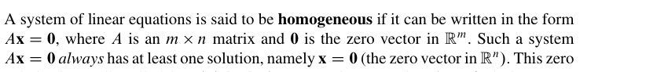
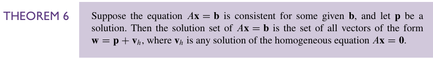
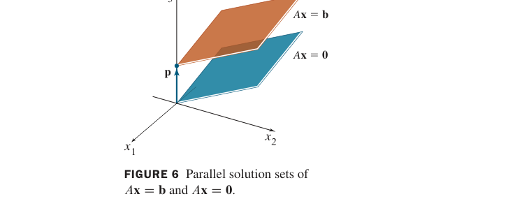

# 1.5 Solution Sets of Linear Systems

## 目录

- [总述](#总述)
- [Homogeneous Linear Systems——齐次线性方程组](#homogeneous-linear-systems齐次线性方程组)
- [Parametric Vector Form——参数向量形式](#parametric-vector-form参数向量形式)
- [Solutions of Nonhomogeneous Systems——非齐次线性方程的解](#solutions-of-nonhomogeneous-systems非齐次线性方程的解)
- [所得结果的检验](#所得结果的检验)
- [有意思的习题](#有意思的习题)

## 总述
在这一章，我们看待线性系统的角度又会发生一个变化，主要是求解层面的。

大体来说，和微分方程的求解类似，我们开始把线性方程组的解集看成是 **通解+特解**

然后你就会发现，这里定义的通解和特解和微分方程很像，但也有一些细微的区别。

在微分方程的求解中，其实当我们说“通解”时，会指向两个不同的事情——一是我已经得到了一个“一般”的解，其系数需要根据边界条件待定；其二是我令等号右边为 0，这样得到的解叫通解。  
在线性系统的求解中，我们采用第二套逻辑：先把每一个等式的右侧都变为 0，得到通解。再去计算原方程组的解，得到特解。

那很显然，我们并不需要特意去计算通解——特解里面一定是包含通解的。只不过我们看出它可能要费一点功夫。

## Homogeneous Linear Systems——齐次线性方程组

它的定义是这样的：

一个可以被写为 $`A\vec{x}=\vec{0}`$ 的方程组被称为齐次线性方程组。

很明显，定义这个事情是奔着通解去的。这个方程组的解显然就是通解。不过很显然这个方程组有个 **平凡解** 即 $`\vec{x}=0`$，这个解太 trivial 了而且对最后方程的解没有影响。所以我们要考虑 **非平凡解** 的情况。那么什么时候存在非平凡解呢？

由我们的 [THEOREM 2](../images/p0047-175_557_529_699.png) 可知，这等价于原方程组至少存在一个自由变量。

也就是说， **齐次线性方程组有非平凡解当且仅当方程（组）至少含有一个自由变量**

书中给出的两个例子生动地展示了一种我们看待最后得到的解的方式。现只把解摘录如下：

$$
\vec{x}=x_{3}\vec{v}, \mathrm{where }\quad \vec{v}=\begin{bmatrix}
 \frac{4}{3} \\
 0\\
1
\end{bmatrix}
$$

$$
\vec{x} = x_{2}\begin{bmatrix} 0.3 \\
1 \\
0
\end{bmatrix}+x_{3}\begin{bmatrix}
0.2 \\
0 \\
1
\end{bmatrix}
$$

可以看到，我们可以把解写成自由变量 $`\times`$ 某个向量的形式。这个向量目前我们还没有命名，我们不妨先给它一个暂用的名字，叫 **解向量**

很自然地，齐次线性方程组的解一定在解向量张成的空间中。事实上，这个空间也就是所有解构成的集合。

## Parametric Vector Form——参数向量形式

这是解的一种表现形式，也就是我们前面提到的 *自由变量$`\times`$解向量*，其实和线性组合的表现形式是一样一样的。

## Solutions of Nonhomogeneous Systems——非齐次线性方程的解

其实就是$`A \vec{x}=\vec{b}\ne \vec{0}`$的解  
我们之前就做过这件事情了，无非是化简增广矩阵到最简形式。我们在这里更进一步地，代入我们的参数表示后，转换成参数向量形式  
比如我们的 Example3 就给出了这样的一个例子

$$
\vec{x} = \begin{bmatrix}
-1 \\
2 \\
0
\end{bmatrix}
+x_{3}\begin{bmatrix}
\frac{4}{3} \\
0 \\
1
\end{bmatrix}
$$

这时解就很自然地分成了两部分。前面没有参数的是特解，后面有参数的是通解。  
一个比较容易看出的事情是：由于特解与自由变量无关，特解要么不存在，要么唯一存在。  
另一个容易看出的事情是：非齐次线性方程的解是齐次线性方程组的解平移特解得到的。英文用 **translated by $`\vec{p}`$** 来表示这件事。

基于此，书上总结了[THEOREM 6](../images/p0074-148_638_571_697.png)

甚至还有温馨提示，告诉我们 [THEOREM 6](../images/p0074-148_638_571_697.png) 只适用于特解存在的情况（其实蛮废话的，不过真数大于零我不也常错吗，所以强调一下也没啥问题）  
这样书上就给出了具体的求解参数向量形式的方法。

翻译一下就是：  
1、行简化增广矩阵至行最简阶梯形  
2、用自由变量表示每一个基本变量  
3、把 $`\vec{x}`$ 中的每一项用自由变量表示  
4、以自由变量为参数将$`\vec{x}`$分解为线性组合

---
## 所得结果的检验

矩阵乘法乘回去。特解应该得到 $`\vec{b}`$，通解应该得到$`\vec{0}`$

## 有意思的习题
[37、Theorem 6的证明](../线代习题选.md#15-37)

