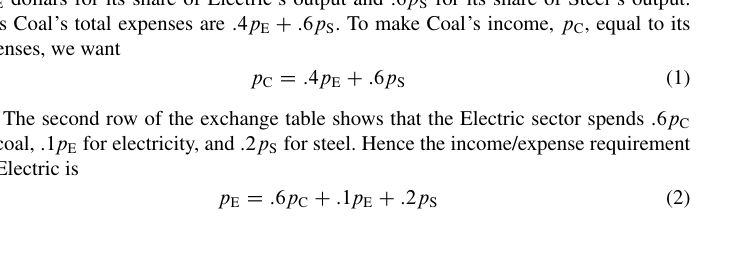
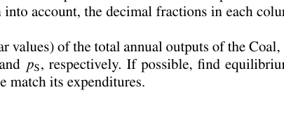
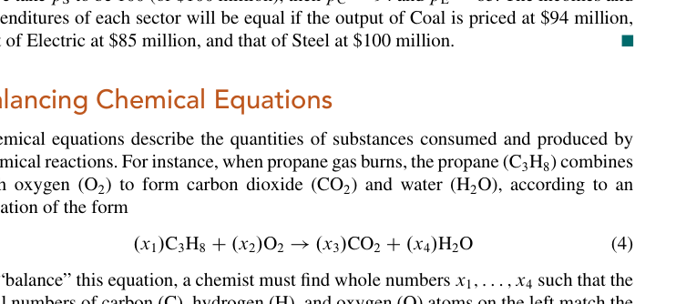

## 经济学上的应用

Leontief的 *exchange model*

这一段很复杂，尤其是它是拿英文写的，而且涉及经济学，我不大懂。下面是一个口语化的中文解释：
1、**经济** 是一个大概念，我觉得它的名字其实不大重要，重要的是它下面有很多**部门**。
2、部门 A 可以和自己有 **联系**，也可以和另一部门 **B** 有联系
3、每个部门都会产出一定的 **东西**，联系的本质就是每个部门如何**分配**自己产出的东西。比如，部门 A 将 20%的产出留给自己，70%的产出给部门 B，10%的产出给部门 C。
4、不同的部门产出不同的东西，每一个东西都可以有一个属于自己的 **价格**，这个价格衡量的是 **珍贵程度**，是定量的，且只与东西的种类有关。**价值** 被认为是“数量” \* “价格”
5、当一个部门 A 将自己的产出分配出去时，它就能获得相应的价值；当它接收其它部门的产出时，他就要支付相应的价值。
6、Leontief 证明的事情是：对于任意一种分配，总存在一种价格，使得对于每一个部门而言，它所获得的价值等于它所支付的价值。

DeepSeek 对上面的解释中的第五、第六点做出了补充和修正，粘贴如下：
**5.** 当一个部门 A 将自己的产出分配出去时，它是在 **支付（支出）** 相应的价值；当它接收其它部门的产出时，它是在 **获得（收入）** 相应的价值。
不过这个点对现在的我们来说不大重要。它纠正的关键在于我们在这个模型中并不真正存在一个通货，而只是以物易物。因此分配出去等价于支出而不是收入。但对于最后的平衡态来说，只要有一对正负就 OK 了。

**6.** 列昂惕夫证明的事情是：**只要所有部门都直接或间接地相互关联（没有孤岛）**，那么对于这种分配结构，**总存在且仅存在一组正的价格（相对比例）**，使得对于每一个部门而言，它所获得的价值（收入）恰好等于它所支付的价值（支出），从而实现整个系统的“收支平衡”。
这个的修正很重要，首先是给出了正确的前提，然后也给出了正确的结论——唯一性和全正性。

我们来看看书上的例题

我们不妨设这个分配矩阵为 $A$，价格则用向量 $\vec{x}$ 表示，那么我们就可以得到：
$$
A \vec{x}=\vec{x}
$$
移项之后就可得到：
$$
(A-I)\vec{x}=\vec{0}
$$
然后就可以化简了，得到的结论是：

可以发现这本质上是一个线性齐次方程组的非平凡解问题，也就意味着自由变量一定存在。可以见[1.5笔记中的相关内容](1.5%20Solution%20Sets%20of%20Linear%20Systems.md#homogeneous-linear-systems齐次线性方程组)

## 化学方程式配平
这个理解起来很简单：元素守恒
本质上仍然是齐次线性方程组的非平凡解问题。

## 在网络中的流
一个**网络**是由一组被称为 **节点** 的点，这些点由被称为 **支路** 的直线或弧线全部或部分连接，支路中流的方向是指定的，而流量（流速）要么给出，要么由变量表示。
一个最基本的假设是：**总流入=总流出**，这对一个网络成立，也就自然地对网络中的每个节点成立
**网络分析**就是在已知部分网络信息时推断出整个网络的全部信息。

