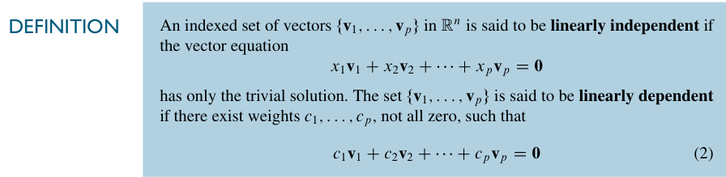
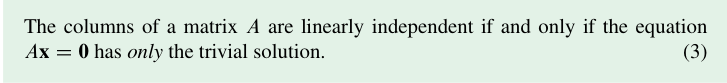

# 线性无关
## 引入
我们在 [1.5 Solution Sets of Linear Systems](1.5%20Solution%20Sets%20of%20Linear%20Systems.md) 中学到的齐次线性方程组可以看作矢量方程，这样我们关注的重心就不再是方程的解，而是那几个矢量了。从这个角度出发，我们就会得到几个矢量 **线性相关/线性无关** 的定义：

其实稍微移项就会发现：

>如果m个矢量线性无关，那么你不能线性组合其中的 n 个矢量（n<m）得到任何一个由剩下的 m-n 个矢量线性组合出的非零矢量。

同样显然的事实是课本上的这句话：

其实就是线性无关的定义。

对于两个矢量的线性无关，我们有这样一个简单的小结论： **只要有一个**向量可以由另一个向量数乘得到，就是线性相关，否则线性无关。  
这里的关键在于 *零向量*。不然是不用加粗的表述的  
当然，你也可以从几何的角度来理解，那就是 *共线* 了  
对于多个向量的线性相关/无关，我们这里也有一个判定：对于一个向量集合 S，**当且仅当** 至少一个 S 中的向量是其它向量的线性组合时，S 中的向量线性相关。也就是这里写的[Theorem7](../images/p0087-104_195_526_278.png)

这里书上还特别给了一个 *warning*，指出在一个线性相关的集合中，并不是所有的向量都可以被表示成其它向量的线性组合。比如说 [这道练习题](../images/p0090-239_645_572_672.png) 所展示的。  
事实上，如果你验证 $\mathbf{z}$ 是 $\mathbf{u,v,w}$ 的线性组合，是没有问题的，得到的会是正确的结论。但是如果你验证 $\mathbf{w}$ 是 $\mathbf{u,v,z}$ 的线性组合就会得到它们线性无关的错误结论。原因是 **列变换** 。  
具体地，你化简前者时是这样的：

$$
\begin{bmatrix}
 3 & -6 & 0 & 3\\
 2 & 1 & -5 & 7\\
 -4 & 7 & 2 &-5
\end{bmatrix}
\to
\begin{bmatrix}
 1 & -2 & 0 &1 \\
 0 & 1 & -1 & 1\\
 0 & 0 & 1 &0
\end{bmatrix}
$$

化简后者时是这样的：

$$
\begin{bmatrix}
 3 & -6 & 3 & 0\\
 2 & 1 & 7 & -5\\
 -4 & 7 & -5 &2
\end{bmatrix}
\to
\begin{bmatrix}
 1 & -2 & 1 &0 \\
 0 & 1 & 1 & -1\\
 0 & 0 & 0 &1
\end{bmatrix}
$$

也就是 *第三第四列交换了一下。*  
对于标准的检验，也就是用一个 **增广矩阵** 的形式，这样的交换不会出问题，因为不涉及最后一列。但是如果只是选择一个来验，这样的方法一定会出问题，因为这样的交换会让有解变成无解，无解变成有解。

[Example4](../images/p0087-172_76_533_137.png) 是一个很简单的例子，但我们要这个例子推广出的结论，即：对任意在 $ℝ^{3}$ 上的集合 $\mathbf{u,v,w}$，如果 $\mathbf{u,v}$ 线性无关，那集合 $\mathbf{u,v,w}$ 线性相关等价于 $\mathbf{w}$ 在 $\mathbf{u,v}$ 张成的平面上。

然后是两个定理，它们描述了一些特殊情况。在这些特殊情况下，这个向量集 *自动地* 线性相关。

即：向量数大于向量中元素的个数。  
证明的核心是说明一定有自由变量。  
这里甚至还特别给了一个 *warning*：这个定理不涉及任何 $p\leq n$ 的情况。我寻思它确实没说啊，咋还要强调一下，大概是有人真的以为$p\leq n$就不能线性相关吧……

即：含有零向量。这显然吧……

习题：  
[线代习题选#1.7 42](../线代习题选.md#17-42)
