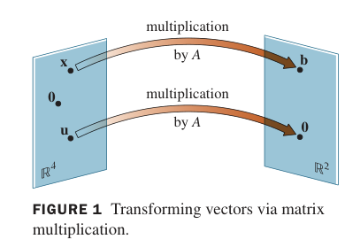
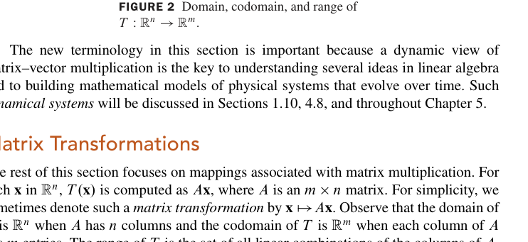
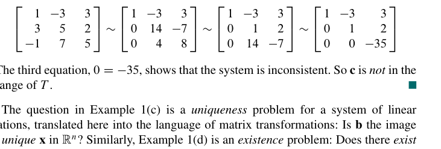
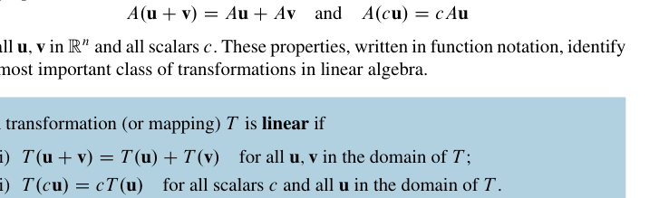

# 线性变换的介绍
矩阵方程和与之相关的向量方程之间的差距只是一个 *记号* 上的差距。但是，一个在线性代数中的矩阵方程可以与向量的线性组合没有直接联系。这发生在我们把矩阵当作一个 **算符** 的时候。  
也就是说，我们本来有一个向量 $\vec{x}$，$A \vec{x}=\vec{b}$ 意味着我们把原来的向量 $\vec{x}$ 通过算符 $A$ 变成了向量 $\vec{b}$。  
这是 **映射** 的感觉。我们把一个 $ℝ^4$ 的向量空间映射到了 $ℝ^2$ 上。更确切的说，这是 **函数** 的感觉，因为对于每一个确定的 $\vec{x}$，有且只有一个 $\vec{b}$ 与其对应。这很美妙，不是吗？  
下面这个图形象地说明了这种感觉：

下面是一个定义：  
一个从 $ℝ^n$ 到 $\mathbb{R^m}$ 的 **变换** $\mathit{T}$ 是指一个从 $ℝ^n$ 到 $\mathbb{R^m}$ 的映射，$ℝ^n$ 被称作 $\mathit{T}$ 的 **定义域** ，$\mathbb{R^m}$ 被称为 $\mathit{T}$ 的 *陪域* 。记为 $\mathit{T}:ℝ^n\toℝ^m$。  
对于任意的 $\vec{x}\inℝ^n$，我们把 $\mathit{T}(\vec{x})\inℝ^m$ 称作 $\vec{x}$ 的 *像*，把像集称为 $\mathit{T}$ 的 **值域**

## 矩阵变换
我们有时会简记矩阵变换为这个形式：

$$
\vec{x}\mapsto A\vec{x}
$$

我们来看 Example 1 的四个问题都是在问什么。

第一个问题就是在简单地做矩阵乘法  
第二个问题就是在找解  
第三个问题在问解的唯一性，也就是我们在 [1.5](1.5%20Solution%20Sets%20of%20Linear%20Systems.md#solutions-of-nonhomogeneous-systems非齐次线性方程的解) 中讨论过的问题。  
第四个问题是是否有解，这是一个 consistent 的判定，也可以用 [1.5](1.5%20Solution%20Sets%20of%20Linear%20Systems.md#solutions-of-nonhomogeneous-systems非齐次线性方程的解) 的方法解决。  
Example 2 是一个很有意思的矩阵，它把一个三维空间上的点投影到了$x_1x_2-$平面

这启发我们：可能不止 *投影* 这个几何操作对应着一个矩阵——所有的几何操作可能都对应着一个矩阵。  
Example 3 的矩阵更有意思了，它被称作一个 *shear transformation*，它只拉伸图形的形状，但不改变它的面积/体积。  
书上没有展开说这件事，我们可以自己研究一下它需要满足什么要求。  
以二维为例。首先很显然的是，对于任意一个 $2\times 2$ 的矩阵，它一般总能把一个线段映成另一条线段。因为：我们不妨设原先线段的两端点是 $(x_{1},y_{1}),(x_{2},y_{2})$，设矩阵为：

$$
A=\begin{bmatrix}
a_{11}  &a_{12} \\
a_{21}  &a_{22}
\end{bmatrix}
$$

对于一个列向量 $`\vec{c}=\begin{bmatrix} dx\\dy  \end{bmatrix}`$，我们总有

$$
A\vec{c}=\begin{bmatrix}
a_{11}dx+a_{12}dy \\
a_{21}dx+a_{22}dy
\end{bmatrix}
$$

而对两个点的映射分别是：$`\begin{bmatrix}a_{11}x_{1}+a_{12}y_{1} \\ a_{21}x_{1}+a_{22}y_{1}\end{bmatrix}`$ $`\begin{bmatrix}a _{11}x_{2}+a _{12}y_{2} \\  a_{21}x_{2}+a_{22}y_{2}\end{bmatrix}`$，显然做差后得到的向量与 $A\vec{c}$ 共线。  
第二个核心问题是面积不变。我们先简单地考虑沿两个正方向的形变。例如：我们先让 x 方向的线段长度不变且方向不变。这样我们有如下的要求：

$$
\Delta y' = a _{21}\Delta x+a_{22}\cdot 0= 0
$$

$$
\Delta x' = a _{11} \Delta x+ a_{12} \cdot 0 = \Delta x
$$

$$
\Delta y''  = a _{21} \cdot  0 +a_{22} \Delta y = \Delta y
$$

这要求 $a_{11}=a_{22}=1,a_{21}=0$.  
也就是说，$A$ 要有如下形式：

$$
\begin{bmatrix}
1&\alpha \\
0&1
\end{bmatrix}
$$

同理，如果是 y 方向，那么就要有

$$
\begin{bmatrix}
1&0 \\
\beta & 1
\end{bmatrix}
$$

的形式  
两个相乘就是一般形式：

$$
\begin{bmatrix}
1+\alpha \beta & \alpha \\
\beta & 1
\end{bmatrix}
$$

我们有时会看到这样一个形式：

$$
\begin{bmatrix}
1 & \alpha \\
\beta & 1
\end{bmatrix}
$$

这并不能保证面积守恒，所以并不属于剪切变换。*只有当 $\alpha\beta<<1$才能这么做*。

## 线性变换
[Theorem 05](Chapter%2001%20Summary.md#theorem-5) 告诉我们矩阵和向量的乘法是满足分配律的，以及乘法中常数的位置是无关紧要的。  
这引出了一个很重要的定义：**线性**。

变换 $\mathit{T}$ 满足这样两条性质就能被称为 **线性**。
- $T(\vec{u}+\vec{v})=T(\vec{u})+T(\vec{v})$
- $T(c\vec{u})=cT(\vec{u})$
要注意的是，这里并没有指定 $T$ 的具体形式。也就是说，这个定义是可以推广的。不过，显然的是，**所有矩阵变换都是线性变换**，因为它们都满足这两条性质。  
由这两条基础性质我们可以很容易的导出下面两条性质：

以及性质4有用的推广：

这一条也被称为 **叠加原理(superposition principle)**  
Example 4 是一个简单的缩放。  
Example 5 是一个旋转矩阵，很有意思。它把整个图形逆时针转了 $90^\circ$。  
Example 6 是一个示例，展示线性变换如何将一种类型的数据转化为另一种类型的数据。

习题：  
[T27](../线代习题选.md#18-27)  
[T38](../线代习题选.md#18-38)