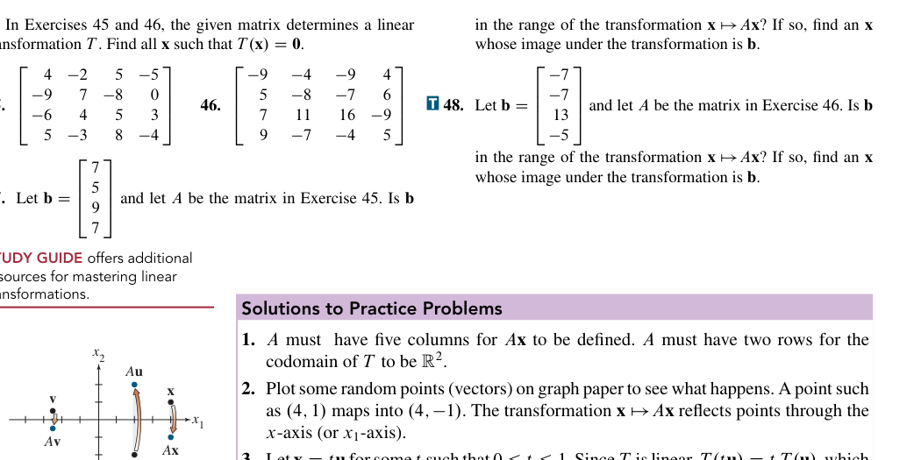
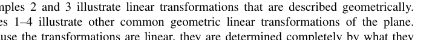
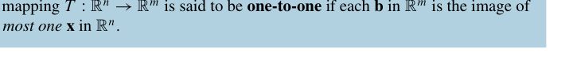
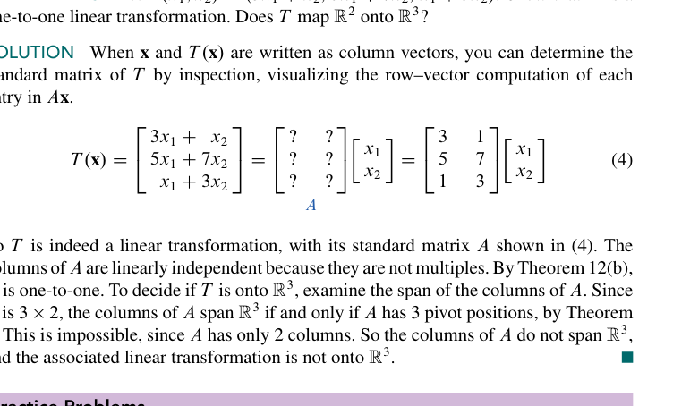

当我们提到线性变换 T 的时候，我们总会想着找到一个 $T(x)$ 的表达式。下面的讨论会说明：事实上，每一个线性变换都与一个矩阵$A$相对应。
而找到这个 $A$ 的关键，就是找到这个线性变换对一个单位矩阵 $I_{n}$ 的每一列做了什么。更具体的：**$T$完全由$T$对单位矩阵的每一列做了什么决定**。

比如这个算例，就很清晰地展现了如何由 $T$ 对单位矩阵的两列 $e_{1},e_{2}$ 的变换推导 $T$ 对任意一个 $x \in \mathbb{R}^2$ 的向量是如何变换的。具体地：先把 $\mathbf{x}$ 拆成线性组合，再利用线性变换的 *线性* 做完这件事情。
同时我们注意方程（2）的形式。这事实上就是一个矩阵和向量的乘法。我们完全可以直接写出 $A$ 来。所以，一般的，我们可以把 $A$ 的形式表示成下面这样：
$$
A = [T(e_{1})\cdots T(e_{n})]
$$
这就是我们的[Theorem 10](../images/p0101-99_502_528_608.png)
这个矩阵被称为 **standard matrix for the linear transformation T，线性变换 T 的标准矩阵**
当然，一个很自然的问题是：我们是否能找到第二个矩阵，同样表示这个 T 变换呢？来看[这个Exercise](../线代习题选.md#19-41)
这就保证了 $A$ 的*唯一性*。

现在我们就可以知道：
> 我们现在知道，从 $R_{n}$ 到 $R_{m}$ 的每一个**线性变换**都可以看作一个**矩阵变换**，反之亦然。“线性变换”这一术语侧重的是映射的一种*性质*，而“矩阵变换”则描述这种映射是如何*实现*的，正如例 2 和例 3 所说明的那样。

下面是一个速查表：

| 变换                | 矩阵                                                                                   | 备注                  |
| ----------------- | ------------------------------------------------------------------------------------ | ------------------- |
| 关于 $x$ 轴反射        | $\begin{pmatrix}1&0\\0&-1\end{pmatrix}$                                              | 行列式 $-1$            |
| 关于 $y$ 轴反射        | $\begin{pmatrix}-1&0\\0&1\end{pmatrix}$                                              | 行列式 $-1$            |
| 关于 $y=x$ 反射       | $\begin{pmatrix}0&1\\1&0\end{pmatrix}$                                               | 交换坐标                |
| 关于 $y=-x$ 反射      | $\begin{pmatrix}0&-1\\-1&0\end{pmatrix}$                                             | 交换并取反               |
| 关于角 $\theta$ 直线反射 | $\begin{pmatrix}\cos 2\theta&\sin 2\theta\\ \sin 2\theta&-\cos 2\theta\end{pmatrix}$ | 过原点直线               |
| 沿 $x$ 轴伸缩         | $\begin{pmatrix}k&0\\0&1\end{pmatrix}$                                               | $k>1$ 拉伸，$0<k<1$ 压缩 |
| 沿 $y$ 轴伸缩         | $\begin{pmatrix}1&0\\0&k\end{pmatrix}$                                               | 同上                  |
| 均匀伸缩              | $\begin{pmatrix}k&0\\0&k\end{pmatrix}$                                               | 整体缩放                |
| 水平剪切              | $\begin{pmatrix}1&k\\0&1\end{pmatrix}$                                               | 面积不变                |
| 垂直剪切              | $\begin{pmatrix}1&0\\k&1\end{pmatrix}$                                               | 面积不变                |
| 到 $x$ 轴投影         | $\begin{pmatrix}1&0\\0&0\end{pmatrix}$                                               | 不可逆                 |
| 到 $y$ 轴投影         | $\begin{pmatrix}0&0\\0&1\end{pmatrix}$                                               | 不可逆                 |
| 到方向 $(a,b)$ 投影    | $\frac{1}{a^2+b^2}\begin{pmatrix}a^2&ab\\ab&b^2\end{pmatrix}$                        | 正交投影                |

## Existence and Uniqueness Questions

>线性变换给出了一个新的理解存在性和唯一性问题的方式。

首先给出两个定义。

那么，"Does $T$ map $\mathbb{R}^n$ onto $\mathbb{R}^m$?"就是一个存在性问题。"Is $T$ one to one?"就是一个唯一性问题。
$$
\begin{bmatrix}
1&-4&8&1 \\
0&2&-1&3 \\
0&0&0&5
\end{bmatrix}
$$
是一个 map $\mathbb{R}^4$ onto $\mathbb{R}^3$ 的矩阵，但显然它不 *one to one*。

下面是一个关于单射的定理。

证明的关键是若不一一映射，则 $T(x)$ 就会有两个不同的 $\mathbf{u},\mathbf{v}$ 被映射到同一个值 $\mathbf{b}$，这样 $(\mathbf{u-v})$ 就会被映射到 $\mathbf{0}$，所以就不只有 $\mathbf{0}$ 这个解。

下面是一个关于满射和单射的定理。

证明 a 的关键是利用 [Theorem4](Chapter%2001%20Summary.md#theorem-4)，说明 $A$ 的列张开 $\mathbb{R}^m$ 和对任意的 $\mathbf{b}\in\mathbb{R}^m,A\vec{x}=\mathbf{b}$ 是有解的这两件事等价。后者就是满射的定义。
证明 b 的关键是利用 [Theorem 11](1.9%20The%20Matrix%20of%20a%20Linear%20Transformation.md#existence-and-uniqueness-questions)，再利用 [1.7](1.7%20Linear%20Independence.md#引入) 的一个结论。

下面是一个算例。

习题选：
[T41](../线代习题选.md#19-41)

