# Chapter 01 Summary

在这一章中，我们学到了很多有关 **线性系统** 的知识。  
我们学到了下面这些定理：
# 定理
#### Theorem 1

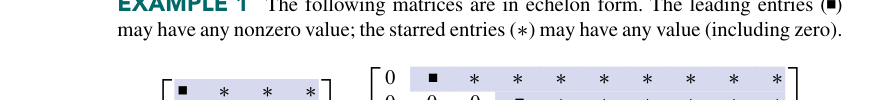

REF 的 *唯一性定理*，证明好像没有想象中的简单。用到了一些后面的思想，到时候再补吧
#### Theorem 2

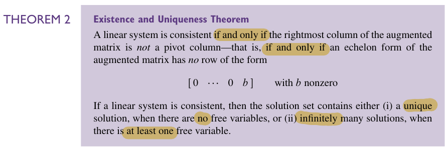

*存在性和唯一性定理*，告诉我们怎么判断一个线性系统是 **consistent** 的还是 **inconsistent** 的，以及解是 **无穷多组** 还是 **唯一的**。  
**consistent** 的判定依赖于 *pivot column* 的判定，也就是增广矩阵的最右一列不是 *pivot column*。  
而 *pivot column* 是一个基于 REF 的概念。  
如果线性系统有解，那么解的个数取决于有无 *自由变量*。有自由变量就有无穷多组解，无自由变量就只有一组解。  
*自由变量* 同样是一个基于 REF 的概念。
#### Theorem 3

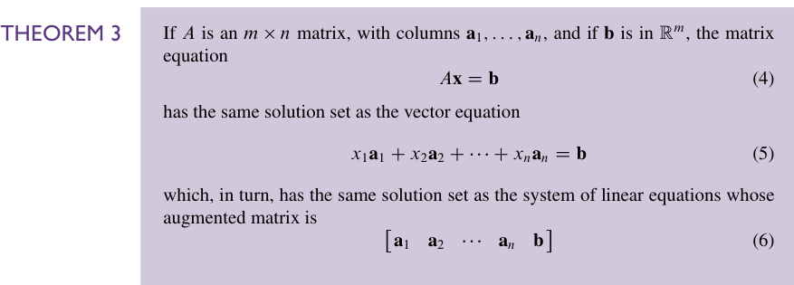

指出的是 *矩阵方程*、 *矢量方程*、 *增广矩阵* 在什么时候等价（或者也可以认为是在说三者的 *等价性* ）
#### Theorem 4

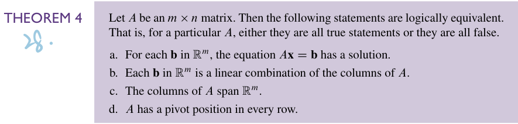

指出了下面四个关于$`m\times n`$矩阵$`A`$的说法等价：
- 对于每一个在 $`ℝ^{m}`$ 上的 $`\mathbf{b}`$，矩阵方程$`A\mathbf{x}=\mathbf{b}`$有解
- 每一个在 $`ℝ^{m}`$ 上的 $`\mathbf{b}`$ 都是矩阵$`A`$的列的线性组合
- $`A`$的列张成空间$`ℝ^m`$
- $`A`$在每一行都有一个 *pivot position*
#### Theorem 5

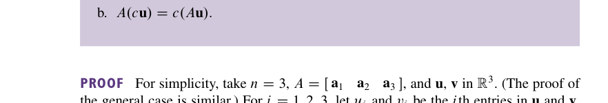

讲的是矩阵和向量运算中的 **分配律** 和 **结合律**
#### Theorem 6

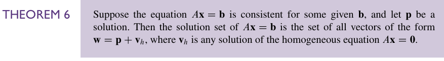

讲的是矩阵方程 $`A\mathbf{x}=\mathbf{b}`$ 的解可以被看做 *通解加特解*，这个通解指的是令 $`\mathbf{b}=\mathbf{0}`$ 给出来的解，特解就是正常的 $`A\mathbf{x}=\mathbf{b}`$ 的解。  
这里也提供了一种 *Uniqueness* 的判定——存在*非平凡通解*等价于线性系统有非唯一解。
#### Theorem 7

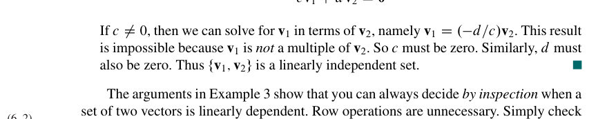

有关 **线性相关** 的性质和判定，也就是 *至少一个* 向量可被其它向量表示 **等价于** 线性相关
#### Theorem 8

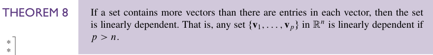

向量数大于元素数的向量集线性相关。
#### Theorem 9

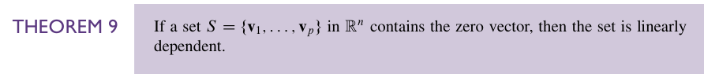

存在 *零向量* 的向量集线性相关。
#### Theorem 10

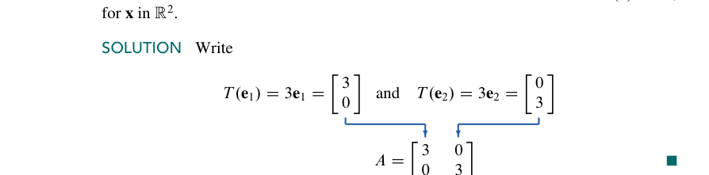

这个是说明每一个线性变换都可以用一个矩阵表示。同时这个矩阵的第 $`j`$ 列事实上就是 $`T(\mathbf{e}_{j})`$。
#### Theorem 11

这是说单射等价于 $`T(\mathbf{x}) = \mathbf{0}`$ 只有平凡解。
#### Theorem 12

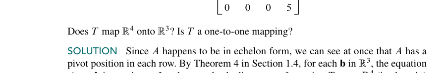

这是说满射等价于 $`A`$ 的列张开 $`ℝ^m`$，单射等价于 $`A`$ 的各列线性无关。

---

# 基本方法
#### 求线性方程组的解。
- 写出增广矩阵( *augmented matrix* )
- 对这个矩阵做基本行变换，把它化简为 **(R)REF**
- 依据 **RREF** 给出最后方程的解。

#### 判断是否线性相关
- 写出增广矩阵$`\begin{bmatrix}\mathbf{a}_{1}&\mathbf{a}_{2}&\cdots&\mathbf{a}_{n}&\mathbf{0}\end{bmatrix}`$
- 不含非平凡解则线性无关
- 含非平凡解则线性相关

#### 写出参数形式的解
1、行简化增广矩阵至行最简阶梯形  
2、用自由变量表示每一个基本变量  
3、把 $`\vec{x}`$ 中的每一项用自由变量表示  
4、以自由变量为参数将$`\vec{x}`$分解为线性组合  
[原文](1.5%20Solution%20Sets%20of%20Linear%20Systems.md#solutions-of-nonhomogeneous-systems非齐次线性方程的解)

---
# 一些等价的说法

#### 01
一个线性系统有解 = 增广矩阵的最右列不是 *pivot column* = 增广矩阵的 *echelon form* 没有行是这个形式：$`\begin{bmatrix}0&\cdots&0&b\end{bmatrix}`$，其中 $`b`$ 非 0。
#### 02
一个线性系统有唯一解 = （有解）且无自由变量
#### 03
一个线性系统有无穷多解 = （有解）且有至少一个自由变量
#### 04
矩阵方程 $`A\mathbf{x} = \mathbf{b}`$  = 矢量方程 $`\sum_{i=1}^{n}\mathbf{a}_{i}x_{i} = \mathbf{b}`$  =  增广矩阵$`\begin{bmatrix}\mathbf{a}_{1}&\mathbf{a}_{2}&\cdots&\mathbf{a}_{n}&\mathbf{b}\end{bmatrix}`$  
我们已经会求解的是增广矩阵。所以其它两个形式也可以用增广矩阵来看，进行求解。
#### 05
 对于每一个在 $`ℝ^{m}`$ 上的 $`\mathbf{b}`$，矩阵方程 $`A\mathbf{x}=\mathbf{b}`$ 有解 = 每一个在 $`ℝ^{m}`$ 上的 $`\mathbf{b}`$ 都是矩阵 $`A`$ 的列的线性组合 = $`A`$ 的列张成空间 $`ℝ^m`$ = $`A`$ 在每一行都有一个 *pivot position*.
#### 06
$`A\mathbf{x} = \mathbf{b}`$ 有解 = $`\mathbf{b}`$ 是 $`A`$ 的列的线性组合 = $`\mathbf{b}`$ 在 Span{$`\mathbf{a_{1}},\mathbf{a_{2}},\cdots,\mathbf{a_{n}}`$}
#### 07
$`A\mathbf{x} = \mathbf{0}`$ 有非平凡解 = 方程含有至少一个自由变量 **等价于** $`A`$ 的各列线性相关。  
这可以看成是等价 [03](Chapter%2001%20Summary.md#03) 的一个特例。
#### 08
*至少一个* 向量可被其它向量表示 **等价于** 线性相关  
当然这个事情更好的操作方式是像 [Chapter 01 Summary#判断是否线性相关](Chapter%2001%20Summary.md#判断是否线性相关) 一样做，因为你一般挺难看出哪个向量可以被其它向量表示的。
#### 09
单射 **等价于** $`T(\mathbf{x}) = \mathbf{0}`$ 只有平凡解 **等价于** $`A(\mathbf{x}) = 0`$ 不含有自由变量**等价于**$`A`$ 的各列线性无关。
#### 10
满射**等价于** $`A`$ 的列张开 $`ℝ^m`$**等价于**对于每一个在 $`ℝ^{m}`$ 上的 $`\mathbf{b}`$，矩阵方程 $`A\mathbf{x}=\mathbf{b}`$ 有解**等价于**每一个在 $`ℝ^{m}`$ 上的 $`\mathbf{b}`$ 都是矩阵 $`A`$ 的列的线性组合 **等价于** $`A`$ 在每一行都有一个 *pivot position*.[Chapter 01 Summary#05](Chapter%2001%20Summary.md#05)

---
# 单箭头
#### 向量个数大于向量元素推出线性相关
#### 含零向量，线性相关
