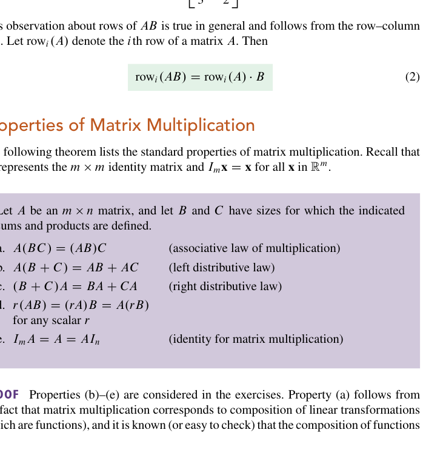
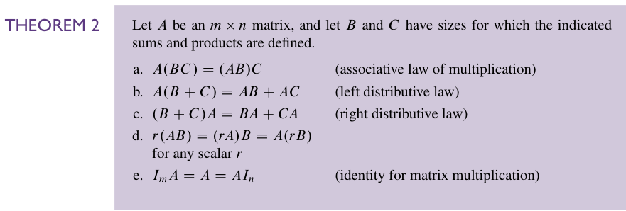
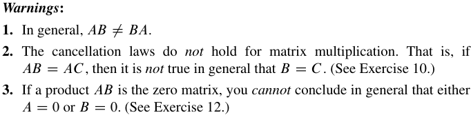
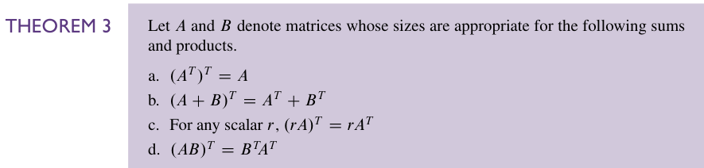
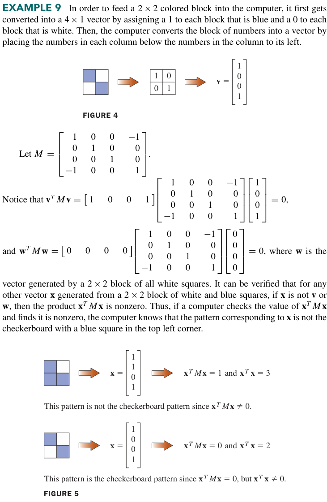
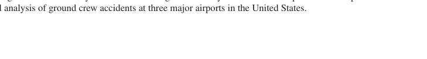
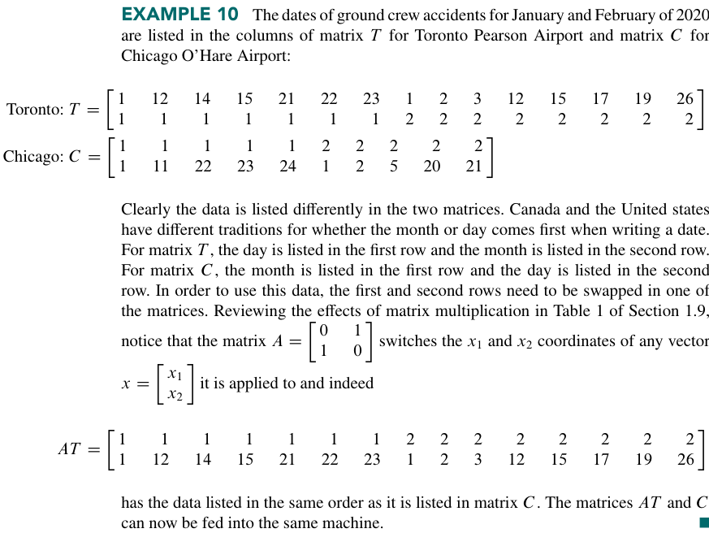

我们第一个要说的是如何 *定位* 一个矩阵内的元素。对于一个 $`m \times n`$ 的矩阵 $`A`$，我们会记它第 $`i`$ 行第 $`j`$ 列的元素为 $`a_{ij}`$，或者是(i, j)-entry of A。比如说第三行第二列的元素 $`a_{32}`$。  
A 的每一列都是一个由 $`m`$ 个实数组成的列表，可以表示一个 $`ℝ^m`$ 的向量。一般来说这些向量都会被记为 $`\mathbf{a_{1},a_{2},\cdots,a_{n}}`$，所以矩阵 $`A`$ 就可以被写为：

$$
A = \begin{bmatrix}
\mathbf{a_{1}}&\mathbf{a_{2}}&\cdots&\mathbf{a_{n}}
\end{bmatrix}
$$

所以 $`a_{ij}`$ 还可以被看成是第 j 个向量的第 i 个元素。  
$`m \times n`$ 的矩阵 A 中的**对角元素**（ *diagonal entries* ）是 $`a _{11},a_{22}, a_{33},\cdots,`$它们共同组成 $`A`$的 **主对角线**。  
一个 **对角矩阵**（ *diagonal matrix* ）是一个 $`n\times n`$ 的方阵，它的非对角元素全为 0。比如 $`n\times n`$ 的单位矩阵，$`I_{n}`$。  
一个 $`n\times n`$ 的方阵，如果元素全为0，那么我们称其为一个 **零矩阵**，写作0  
如果两个矩阵有相同的大小，且每一列都相等，则称这两个矩阵**相等**  
如果两个矩阵都是 $`m\times n`$ 的，那么它们的和也是一个 $`m\times n`$ 的矩阵，这个矩阵的第 j 列是两个矩阵第 j 列的和。  
如果 r 是个标量而 A 是个矩阵，则数乘 $`rA`$ 是一个矩阵，这个矩阵的每一列都是 $`A`$ 对应列的 $`r`$ 倍。

### 矩阵乘法
当矩阵 $`B`$ 乘上向量 $`\mathbf{x}`$ 时，它把 $`\mathbf{x}`$ 变换到 $`B\mathbf{x}`$，如果再把这个向量用 $`A`$ 作用，那么就会得到 $`A(B\mathbf{x})`$。因此 $`A(B\mathbf{x})`$ 是一个由 $`\mathbf{x}`$ 经过两次映射得到的向量，正如我们在 [1.8](../第一章/1.8%20Introduction%20to%20Linear%20Transformations.md) 里看到的。如果我们想用一个单独的矩阵$`(AB)`$代表这两次作用。也即：

$$
A(B\mathbf{x}) = (AB)\mathbf{x}
$$

如果 A 是 $`m \times n`$，$`B`$ 是 $`n\times p`$，然后 $`\mathbf{x} \in ℝ^p`$，那么我们就会有：

$$
\begin{aligned}
B\mathbf{x} &= \sum_{i=1}^{p}x_{i}\mathbf{b}_{i} \\
A(B(\mathbf{x})) &= A(x_{1}\mathbf{b_{1}})+\cdots+A(x_{p}\mathbf{b}_{p}) \\
&=x_{1}A(\mathbf{b_{1}})+\cdots+x_{p}A(\mathbf{b}_{p}) \\
\end{aligned}
$$

所以我们就有了关于(AB)的一个形式上的表示：

$$
A(B\mathbf{x}) = (AB)\mathbf{x} = \begin{bmatrix}
A\mathbf{b_{1}} & A\mathbf{b_{2}}&\cdots&A\mathbf{b}_{p}
\end{bmatrix}\mathbf{x}
$$

也就是 $`AB = \begin{bmatrix}A\mathbf{b_{1}} &A\mathbf{b_{2}}&\cdots&A\mathbf{b}_{p}\end{bmatrix}`$，这样我们就找到了一个**矩阵乘法**的定义。

当然不像是实数之间的乘法，你任意给两个实数乘法都是有定义的。矩阵之间的乘法在大部分时候都是没有定义的。注意到我们上面的定义要求了 A 的列数等于 B 的行数，这是一个很强的要求。  
事实上来说我们做乘法的过程得到的矩阵大小相当于你把这个中间项 n 抹掉，然后一头一尾，得到一个 $`m\times p`$ 的矩阵。  
当然，如果 AB 本身是有定义的，那么对于它的某一个具体的元素 $`(AB)_{ij}`$，我们是有更快的算法的。

$$
(AB)_{ij} = \sum_{l=1}^{n}a_{il}b_{lj}
$$

从这个公式中我们也能看出结果矩阵的大小是与 $`n`$ 无关的。  
验证事实上就是做代入。

这是一个比较有意思的算例。（2）是重点，它告诉我们乘法结果的第 i 行可以由 A 的第 i 行乘上 B 直接得到。

下面是这些矩阵运算的性质。我把加法、数乘的和矩阵乘法的放在一块。

对于 [Theorem 1](../images/p0124-150_65_571_138.png)，我们也可以像 [Theorem 2](../images/p0128-148_128_571_271.png) 一样给出定律名。a, b, c 反映的是矩阵加法的交换律，结合律和单位元，d,e, f 反映的是数乘的分配律和结合律。当然，交换律也没有什么不成立的理由。*标量* 毕竟拥有着最低的地位。这在 [Theorem 2](../images/p0128-148_128_571_271.png) 的 d 看得更清楚一些。只不过我们确实很少说 $`Ar`$，这样看起来像是把一个矩阵作用在一个标量上，确实不大合规，但是其实又不大影响理解。 **但是果然我们还是不要这么写为好。**

书上给出了一个为什么 $`AB\ne BA`$ 的说法，我觉得挺对的：因为 $`AB`$ 反映了一个 A 各列的线性组合，$`BA`$ 反映的则是 B 各列的线性组合。这说明了为什么即使 A、B 都是方阵，它们都有定义，一般而言仍然不相等。  
所以在矩阵乘法中，$`AB=BA`$ 是一个很反常的事，反常到如果它真的成立，应该会有不少性质。我们给这个性质命名为 **可对易性**，或者是 **可交换性** ( *A and B commute with one another* )

书上给出了 3 个 warning，来告诉我们矩阵代数和实数代数的不同。

1. 一般地，$`AB \neq BA`$。
2. *消去律*对矩阵乘法**不**成立。也就是说，如果 $`AB = AC`$，一般情况下**不能**推出 $`B = C`$。（见习题10。） **这一点对 $`AB=AC=I`$ 甚至都不一定成立，除非A是方阵**
3. 如果乘积 $`AB`$ 是零矩阵，一般情况下你**不能**断定 $`A = 0`$ 或 $`B = 0`$ 中至少有一个成立。（见习题12。）

### 矩阵的幂
如果 A 是一个 $`n\times n`$ 的方阵，$`k`$ 是一个非负整数，那么 $`A^k`$ 表示连乘 $`k`$ 次 $`A`$。即：

$$
A^k = \underbrace{A\cdots A}_{k}
$$

如果 $`A`$ 是非零的，那么 $`A^k`$ 相当于作用 k 次 A，如果 $`k=0`$，那么 $`A^0`$ 就应该等于单位矩阵。  
矩阵的幂在理论和应用上都很有用，参见 2.6节，5.9节和后文

### 矩阵的转置（Transpose of a Matrix）
定义是简单的：

$$
(A^T)_{ij}=A_{ji}
$$

然后就是一些性质：

前三条都很显然。这确实也反映了一点，就是转置应该也是线性的。第一条也可以说它反映了对合性，也即：一个变换对一个值作用两次之后回到原值。  
不过第四条值得注意。也就是 $`(AB)^T = B^TA^T`$ 也就是矩阵乘法的转置并不等于先转置再相乘。虽然这是显然的……因为如果你真这么做了大概率是无定义的。$`B^TA^T`$ 才是一定有定义的那一个。这条定义的证明参见[线代习题选#2.1 T41](../线代习题选.md#21-t41)  
当然，即使有定义，$`(AB)^T = A^T B^T`$ 也显然不一定成立，它要求 $`A^T,B^T`$ 是可交换的。或者说，$`A,B`$ 是可交换的。

下面将是一个很有意思的例子。它将告诉我们：**矩阵转置和矩阵乘法可以被用来确定一个 $`2\times 2`$ 的上色的方格是否和某个特定的样式匹配。**

很显然这里的关键在于找到这个 $`M`$，可惜的是我们现在并不会知道怎么找 M，要等到比较后面，6.3节 的 example 5 会给出一种找到 M 的方法。

当然，对数据的一些整理(scrub data)也可以用矩阵来完成。比如说下面这个例子。

就把两行内容对调了，利用到了我们在 1.9学过的[这里](../第一章/1.9%20The%20Matrix%20of%20a%20Linear%20Transformation.md)的一个矩阵

习题：  
[线代习题选#2.1 T11](../线代习题选.md#21-t11)  
[线代习题选#2.1 T30~T34](../线代习题选.md#21-t30t34) 这一连串的习题给出一个类似于实数倒数的概念。  
[线代习题选#2.1 T35-36](../线代习题选.md#21-t35-36) 这里要给出一个内积和外积的定义。这里我们直接引用

> 这里引入了内积（标积）和外积的概念。
> 内积是 $`1\times n`$ 和 $`n\times 1`$ 的乘法，最后当然得到一个数。
> 外积是 $`n\times 1`$ 和 $`1 \times n`$ 的乘法，最后会得到一个 $`n \times n`$ 的矩阵。
> 分别可以写成 $`\mathbf{u^T v}`$ 和 $`\mathbf{uv^T}`$
[线代习题选#2.1 T47](../线代习题选.md#21-t47) 幂零矩阵  
[线代习题选#2.1 T48](../线代习题选.md#21-t48) 双随机矩阵

补充：

1、  
有关“标量的地位”。这里有一个比较好的想法。  
我们说“标量的地位是很低的”，是因为在乘法中它可以放在任意的地方，不像矩阵一样需要考虑顺序问题。这其实是因为你可以把标量写成：$`rI`$。而单位矩阵和任意矩阵都可对易，这就解释了标量的地位问题。  
对于这样的矩阵，我们也有一个专有名词：**数量矩阵**。  
一个小结论是：只有数量矩阵可以和任意矩阵对易。  
下面是一个证明：

直接通过矩阵元素进行计算。

设 $`A = (a_{ij})`$ 与任意 $`n \times n`$ 矩阵可交换。  
取初等矩阵 $`E_{ij}`$（仅第 $`i`$ 行第 $`j`$ 列元素为 1，其余元素为 0）。因为 $`A`$ 与任意矩阵可交换，所以 $`A E_{ij} = E_{ij} A`$。

**1. 计算 $`A E_{ij}`$**  
矩阵 $`A E_{ij}`$ 的第 $`k`$ 行第 $`l`$ 列元素为 $`\sum_m a_{km} (E_{ij})_{ml} = a_{ki} \delta_{jl}`$（其中 $`\delta_{jl}`$ 为克罗内克函数）。  
这意味着 $`A E_{ij}`$ 的第 $`j`$ 列是 $`A`$ 的第 $`i`$ 列，其余列全为 0。

**2. 计算 $`E_{ij} A`$**  
矩阵 $`E_{ij} A`$ 的第 $`k`$ 行第 $`l`$ 列元素为 $`\sum_m (E_{ij})_{km} a_{ml} = \delta_{ki} a_{jl}`$。  
这意味着 $`E_{ij} A`$ 的第 $`i`$ 行是 $`A`$ 的第 $`j`$ 行，其余行全为 0。

**3. 比较元素**  
令 $`A E_{ij} = E_{ij} A`$，比较两边矩阵的元素：
- 当 $`k \neq i`$ 且 $`l = j`$ 时，左边元素为 $`a_{ki}`$，右边元素为 0。因此 $`a_{ki} = 0`$。由于 $`i`$ 和 $`k`$ 是任意不相等的行号，这说明 $`A`$ 的所有非对角线元素均为 0，即 $`A`$ 是对角矩阵。
- 当 $`k = i`$ 且 $`l = j`$ 时，左边元素为 $`a_{ii}`$，右边元素为 $`a_{jj}`$。因此 $`a_{ii} = a_{jj}`$。由于 $`i`$ 和 $`j`$ 是任意行号和列号，这说明 $`A`$ 的所有对角线元素均相等。

综合以上两点，$`A`$ 的对角线元素全相等，非对角线元素全为 0，因此 $`A`$ 是数量矩阵。

