在这一节，我们要学习如何对矩阵求逆。这是一个代数中的很基本的问题：我们求逆，其实就是要找到一个 *乘法的逆元*，使得这个逆元和我们的原矩阵乘积等于单位矩阵。  
根据我们上一节的习题 [线代习题选#2.1 T30~T34](../线代习题选.md#21-t30t34) 的论述，我们已经知道，只有方阵才有可能有逆元。但是显然不是每一个方阵都存在这样一个逆元。我们先定义 **可逆** 这个概念。  
一个 $n\times n$ 的矩阵 A 是可逆的，如果我们能找到一个$n \times n$的矩阵C满足

$$
CA = AC =I_{n}
$$

那么我们称 $C$ 为矩阵 $A$ 的逆，事实上，$C$ 被 $A$ 唯一确定。这也很显然，因为我们已经知道了左逆一定等于右逆，这样的话如果有另一个矩阵 $B$ 也为 A 的逆，那么我们就一定可以 C 左逆而 B 右逆，得到 C=B.  
我们会把 $C$ 记作 $A^{-1}$，所以我们就有：

$$
A^{-1}A = AA^{-1} =I_{n}
$$

如果一个矩阵是不可逆的，我们有时候也叫它“ *singular matrix* ”，可逆的就是" *nonsingular matrix* "  
对于一个 $2\times 2$ 的矩阵，我们有下面这个定理：

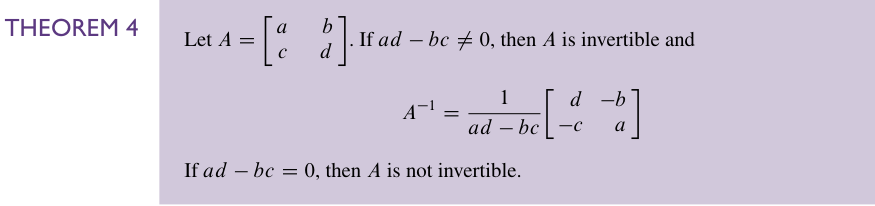

我们会在 *exercise 35, 36*中证明这个定理。  
这个量：$ad-bc$ 被称为 A 的 **determinant**，即行列式。可以看出，它确实决定着 A 有没有逆。我们的记法是:

$$
\det A = ad - bc
$$

至少在 $2\times 2$ 的时候，$A$ 可逆当且仅当 $\det A \ne 0$。  
我们还有这样一个定理：

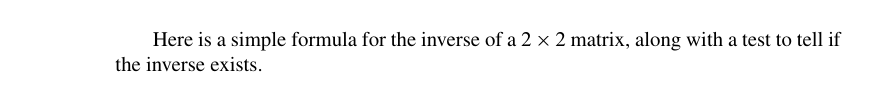

这个定理告诉我们的第一件事情是：如果 系数矩阵A 可逆，则解唯一。  
第二件事情是：如果 A 可逆，那么$Ax$是一个满射  
这意味着它就会有很多性质。[Chapter 01 Summary#09](../第一章/Chapter%2001%20Summary.md#09) 中给出了一些。这也让我们意识到矩阵的逆的重要性。

这里有一个和物理有关的例子：

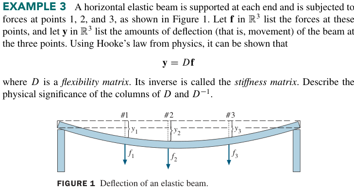

这里感觉是要用微小量的，要不然关系恐怕不会那么线性。

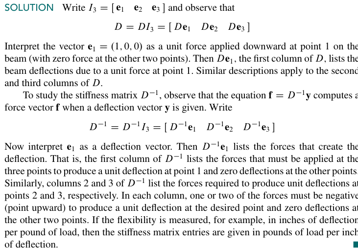

这个解里面比较容易让人迷惑的是 $\mathbf{e_{1},e_{2},e_{3}}$，这个看着容易让人以为是三个方向的单位矢量。但其实不是，是图中给的那三个方向的单位矢量。其实这三个矢量是相等的，在数学上，但是因为它们的作用点不同，所以其实是三个不同的矢量（说的有点绕了，能理解就好）。

下面是一个定理，给出几个 *useful facts*

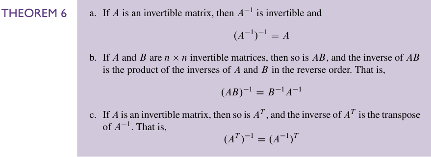

1、如果 A 可逆，那么这个逆矩阵本身也可逆，而且$(A^{-1})^{-1}=A$  
……这几乎是显然的

2、如果 A、B 都可逆，那么 $AB$ 也可逆，有$(AB)^{-1}=B^{-1}A^{-1}$  
去考虑 $B^{-1}A^{-1}AB$ 这个乘积。首先它肯定存在，因为大家都是 $n\times n$ 的矩阵。然后利用结合律就很显然了。

3、如果 A 可逆，那么 A 的转置可逆，且转置的逆是逆的转置。  
去考虑 $(AA^{-1})^T=(A^{-1})^TA^T=I$ 就好了。

然后这第二个性质还可以推广。其实和对矩阵求转置是差不多的。关键都是逆序。

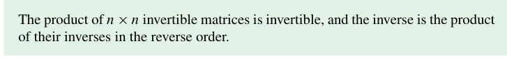

也就是，可逆矩阵的乘积是可逆的（乘积不改变矩阵的可逆性），然后这个逆矩阵是它们分别取逆的反向乘积。  
也就是说，取逆作用于乘法和转置作用于乘法是一样的感觉。最后都是要 *reverse*。

这里有一个很有意思的事。为了表示它的重要，以及我第一次看到这个东西带给我的震撼，我决定引用原文：

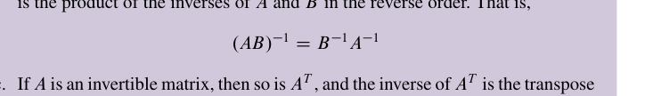

> [!NOTE]
> 这里有一个很重要的逆矩阵和行变换的联系，从这个联系出发，我们会得到一种计算逆矩阵的方法：正如我们将要看到的，一个逆矩阵可以被行简化成一个单位矩阵，通过观察行简化的过程，我们就可以得到 A 的逆。

### Elementary Matrices （初等矩阵）
一个 **初等矩阵** 是由单位矩阵经过一次行变换得到的矩阵。比如说这几个：

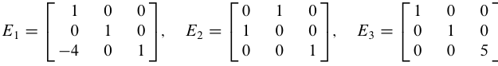

那我们显然不会无缘无故的就把几个矩阵拉出来，赋予一个特殊的“初等矩阵”的名头的。它们之所以会被命名成“初等矩阵”，是因为它们事实上代表了三个行变换。我们可以分别看一下 $E_{1}A,E_{2}A,E_{3}A$ 的值。

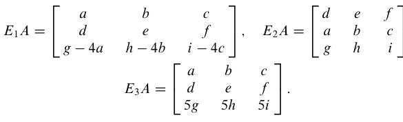

把这三个矩阵左乘在 A 上，得到的矩阵就是对 A 做相应行变换的结果！  
事实上，这个 $E_{1}$ 的左乘不仅可以作用在 A 这样一个 $3 \times 3$ 的矩阵。你应该已经想到了，它可以作用在一个任意的 $3 \times n$ 的矩阵上，得到的最后结果就是把这个矩阵行变换过的结果！

所以我们就有了这样一个结论：

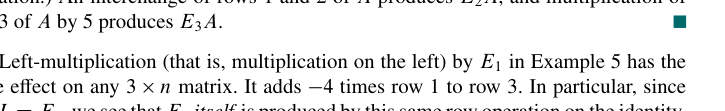

如果一个基本行变换作用在了一个 $m \times n$ 的矩阵 A 上，那么最后的结果就可以被写成 $EA$，这个 E 是一个 $m \times m$ 的矩阵，通过对单位矩阵 $I_{m}$ 做相同的行变换得到。

行变换的可逆性就很自然地带来了 $E$ 的可逆性。

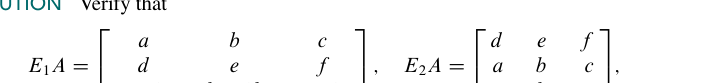

所以其实初等矩阵的逆都很好找。

下面这个定理给出了一个比较好的方法来 **看出** 一个矩阵是否可逆。

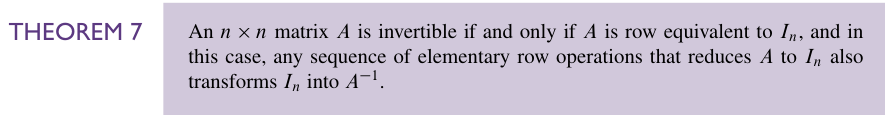

也就是说：1、可逆的矩阵和单位矩阵是行等价的。  
2、**任何的把A简化到单位矩阵的行变换的序列都可以把单位矩阵转化成A的逆**

下面给一个书上的证明：

假设 A 可逆，那么根据 [Theorem 5](../images/p0137-105_160_527_204.png)，我们就可以知道 $A\vec{x}$ 是满射，然后再根据上一章的定理 4 [Theorem 4](../第一章/Chapter%2001%20Summary.md#theorem-4)，我们就可以得到 A 在每一列都有一个 *pivot position*。然后又因为 A 是个方阵，所以这些 *pivot position* 只能在对角上，这意味着 A 的 REF 一定是单位矩阵。也就是$A\sim I_{n}$  
然后如果 $A\sim I_{n}$，那么就可以给出一个基本行变换的序列，这个序列的作用可以看成是一系列初等矩阵的乘积的作用，显然这就是 A 的逆了。然后如果我们作用在 $I_{n}$ 上，那显然就会得到这个逆嘛。而这等价于对单位矩阵做相同的行变换。

于是我们就有了一个计算 $A^{-1}$ 的算法。

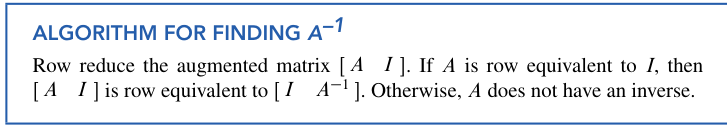

这就把求逆变成了行简化。

