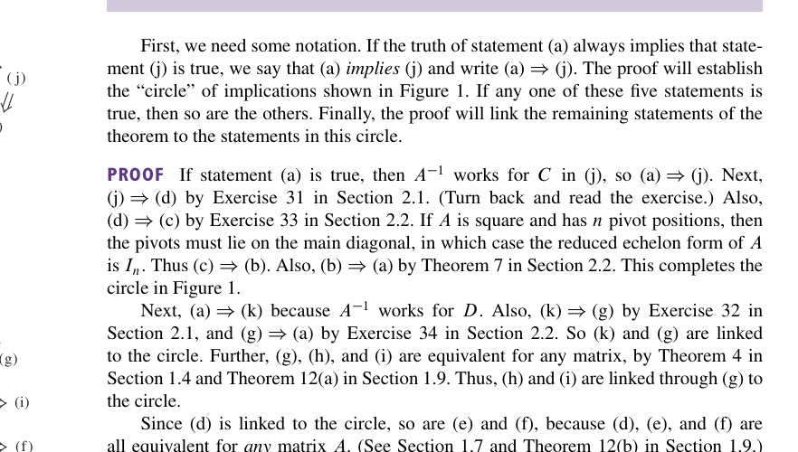
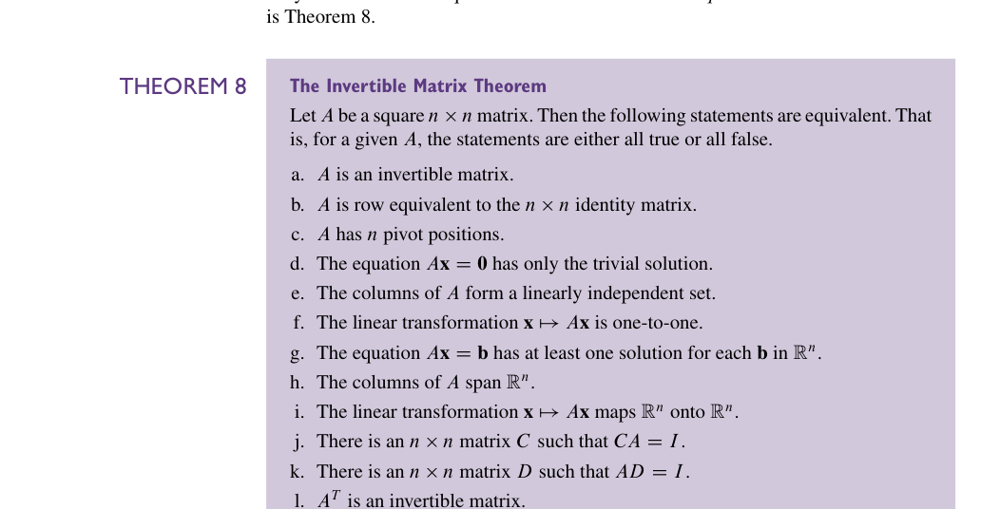
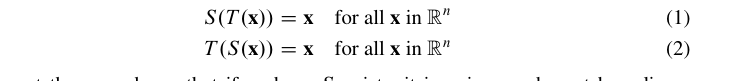
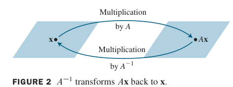
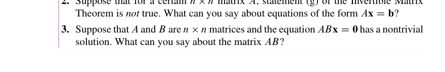

# 2.3 Characterization of Invertible Matrices

本节回顾第 1 章引入的大部分概念，把它们与 $`n`$ 个未知数的 $`n`$ 个线性方程组、以及**方阵**联系起来。主要结果是下面这个定理（ **可逆矩阵定理**  ）：

对于一个 $`n\times n`$ 的方阵，下面这些命题是等价的。也就是说，它们 *要么全对，要么全错*。

1、A 可逆  
2、A 和 $`n\times n`$ 的单位矩阵行等价。  
3、A 有 n 个 *pivot position*  
4、方程$`A\mathbf{x}=\mathbf{0}`$只有平凡解  
5、$`A`$的各列线性无关  
6、A 对应一个单射  
7、$`A\mathbf{x}=\mathbf{b}`$对于任意一个$`\mathbf{b}`$有解  
8、A 的各列张开$`ℝ^n`$  
9、A 对应一个满射  
10、A 存在左逆  
11、A 存在右逆  
12、A 的转置可逆

证明如下：

其实更值得看的是两个图，证明的文字反而是没有那么重要的。同时这里用到了不少的定理和练习题。我们也罗列一下。  
比如：  
[线代习题选#2.1 T30~T34](../线代习题选.md#21-t30t34)  
[线代习题选#2.2 T33-34](../线代习题选.md#22-t33-34)  
[2.2里的Theorem 07](2.2%20The%20inverse%20of%20a%20matrix.md#elementary-matrices-初等矩阵)  
[Chapter 01 Summary#Theorem 4](../第一章/Chapter%2001%20Summary.md#theorem-4)  
[Chapter 01 Summary#Theorem 12](../第一章/Chapter%2001%20Summary.md#theorem-12)  
[2.2的Theorem 06](2.2%20The%20inverse%20of%20a%20matrix.md)  
[1.7 Linear Independence](../第一章/1.7%20Linear%20Independence.md) 的相关知识。

基于我们在 [Theorem 05](2.2%20The%20inverse%20of%20a%20matrix.md) 学到的知识，这个（7）还可以被写成是 $`A\mathbf{x}=\mathbf{b}`$ 对每一个 $`\mathbf{b}`$ 都有唯一解。主要原因是 $`A\mathbf{x}=\mathbf{0}`$ 只有平凡解。

下面是一个简单的事实：

这个可逆矩阵定理把 $`n \times n`$ 的矩阵分为了两类：一类是可逆的（非奇异的），另一类是不可逆的（奇异的）。每一个定理里的命题事实上给出了可逆矩阵的一个性质。它们的反命题也就给出了不可逆矩阵的性质。比如说，一个 $`n \times n`$ 的奇异矩阵就 **不** 行等价于一个单位矩阵，也没有 n 个 *pivot position*，有着线性相关的列。我们在练习中会看到这一点的。

这个定理是很有用的，因为它链接起了很多的概念，比如说线性无关，存在性和唯一性问题。当然，我们也要强调：这个可逆矩阵定理 **只适用于方阵**，我们不能把它运用在一般的矩阵上。但是这也很强了。

### 可逆线性变换
回忆 [2.1 Matrix Operations](2.1%20Matrix%20Operations.md) 中矩阵乘法和线性变换之间的联系。当矩阵 A 可逆的时候，我们就可以把这个方程

$$
A^{-1}A\mathbf{x} = \mathbf{x}
$$

看成是一个线性变换的命题，比如这个图

一个线性变换 $`T:ℝ^n \to ℝ^n`$ 是可逆的，如果存在这样一个变换 $`S:ℝ^n \to ℝ^n`$，使得：

$$
\begin{aligned}
S(T(x))=x \\
T(S(x)) = x
\end{aligned}
$$

注意这里其实没有要求 S 是线性的，但是我们马上就能看到：如果 S 存在，那么它唯一，且它是一个线性变换。我们称 S 是 T 的逆，记作 $`T^{-1}`$。

证明如下：如果 T 可逆，那么 T 是一个满射（对于任意的 $`\mathbf{x}`$ 都有解 $`S(\mathbf{x})`$），这意味着 A 可逆；  
如果 A 可逆，那么让 $`S(\mathbf{x})=A^{-1}(\mathbf{x})`$，那么 S 就是一个线性变换，然后 $`S`$ 显然满足这两个方程。于是 $`T`$ 可逆。  
对 $`S`$ 唯一性的证明可以看 *exercise 47*
