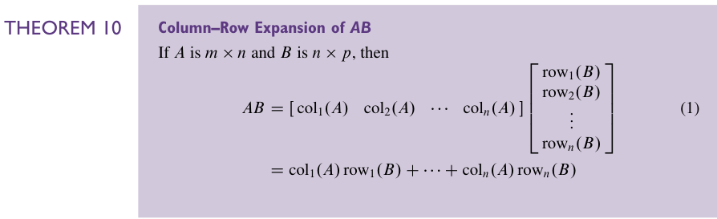
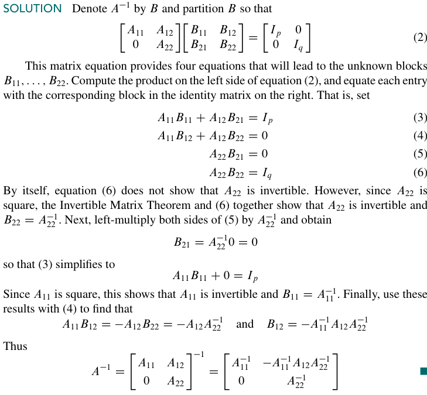

这一节的核心内容是 **分块矩阵**，也即，把矩阵按照一定的规则，分成一个一个小块。  
这一件事情其实我们以前已经在做了，比如说，之前我们就已经会把一个矩阵看成是一列一列的，而不是一个个的元素。这是一个很有用的看待矩阵的方式。我们已经用它定义过很多东西，比如说矩阵和向量的积。  
我们可以推广这个方法。比如说下面这个矩阵：

$$
A = \left[
\begin{array}{ccc|cc|c}
3 & 0 & -1 & 5 & 9 & -2 \\
-5 & 2 & 4 & 0 & -3 & 1 \\
\hline                         % 绘制水平分隔线
-8 & -6 & 3 & 1 & 7 & -4
\end{array}
\right]
$$

也就可以被写成这个样子：

$$
A = \begin{bmatrix}
A _{11} & A_{12} & A_{13} \\
A _{21} & A_{22} & A_{23}
\end{bmatrix}
$$

它的每一个 *entry* 都是一个小的矩阵。  
当然，如果我们只给出分块这一个概念，似乎是没有什么用的。不过至少，这是一个抽象。就像我们在配电脑的时候会把 CPU 里面复杂的电路略去，抽象成一个中央处理器一样。  
分块矩阵的加法和数乘（尤其是数乘）几乎是显然的。当然，加法的要求会严格一点。不止要求两个矩阵的大小是一样的（ *但是只要大小一样加法就被定义了，只不过分块矩阵的加法就不被定义* ），还需要两个矩阵的分块方式相同。虽然这也很显然……  
分块矩阵的乘法是更有意思的。首先进行矩阵乘法的两个矩阵需要有合适的大小（$m\times n$ 和 $n \times p$）。然后我们的分块也要合理。对第一个矩阵列的划分要和第二个矩阵的行的划分相同（ *很合理，因为两个矩阵唯一相同的就是这个 $n$ 了* ）。  
这样的话我们就说这个对于 A、B 的分块方式是 *conformable for block multiplication* 的。  
然后我们的分块乘法过程和矩阵乘法是一模一样的，只是现在的 *entry* 不再是一个数而是一个矩阵，然后乘法不再是实数之间的乘法而是矩阵之间的乘法。  
当然，我们一定会问：这个和我们原来对矩阵乘法的定义等价吗？答案是：是的！当然，这个证明需要一定的步骤，我们先略去不表。  
这里我们有一个计算矩阵乘法的**列-行展开**。区别于我们在 [2.1 Matrix Operations](2.1%20Matrix%20Operations.md#矩阵乘法) 里看到的 **行-列规则**，那个我们的注意力在一个个元素上，因为我们实际计算了一堆 *内积* 的和，列-行展开是一个个 *外积* 的和，我们的每一项都会是一个完整大小的矩阵。（内积和外积的定义可以看[线代习题选#2.1 T35-36](../线代习题选.md#21-t35-36)）

分块矩阵的逆是另一个重要的课题，可以来看一个算例：

这个是所谓“**分块上三角矩阵**”的逆，这个形式事实上是松于一个上三角矩阵的：它只要求矩阵的左下角有一个长方形的 0 矩阵，这个长方形的长和宽的加和是 n。  
一个“**分块对角矩阵**”是除了对角线以外所有的 *entries* 都是 *0 矩阵* 的矩阵。

这里有一个很好的习题 [线代习题选#2.4 T 17-18，20-22](../线代习题选.md#24-t-17-1820-22) 是值得一看的。