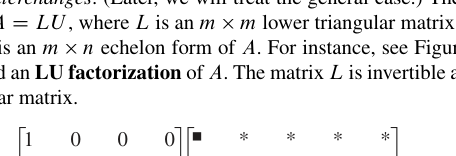
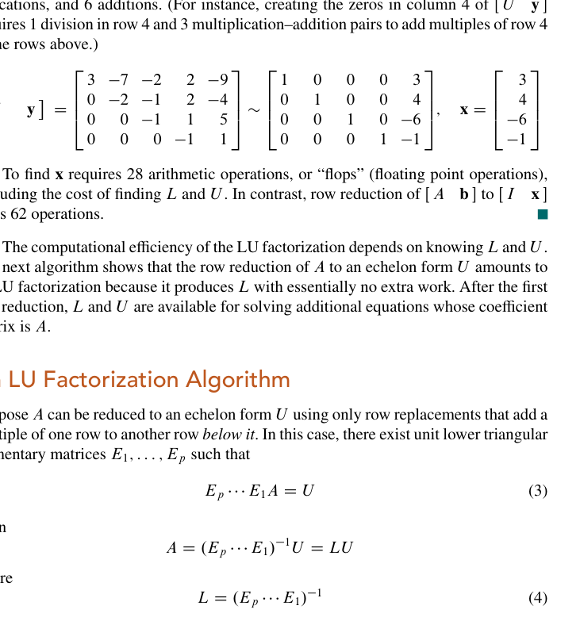
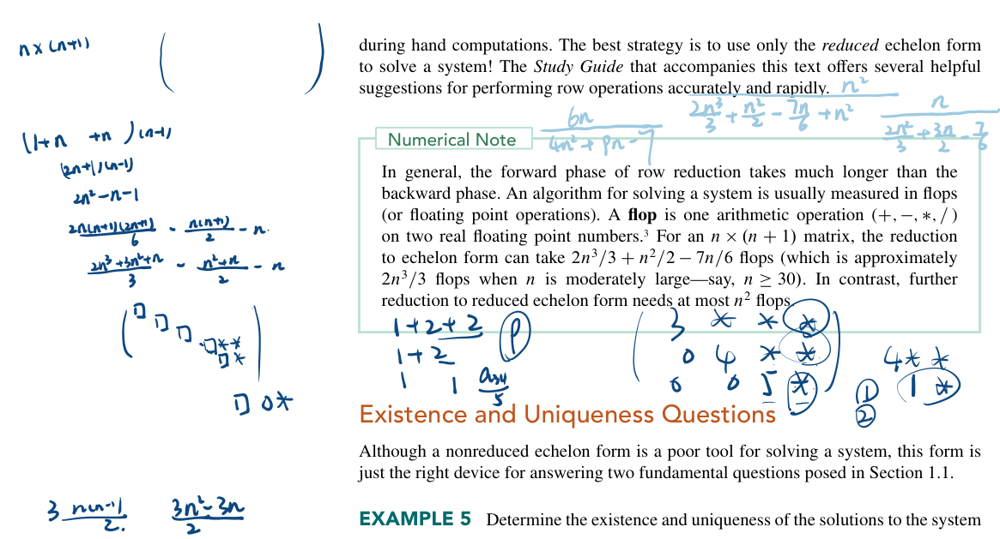
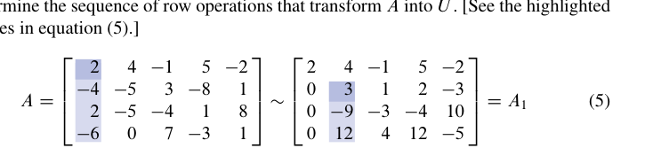
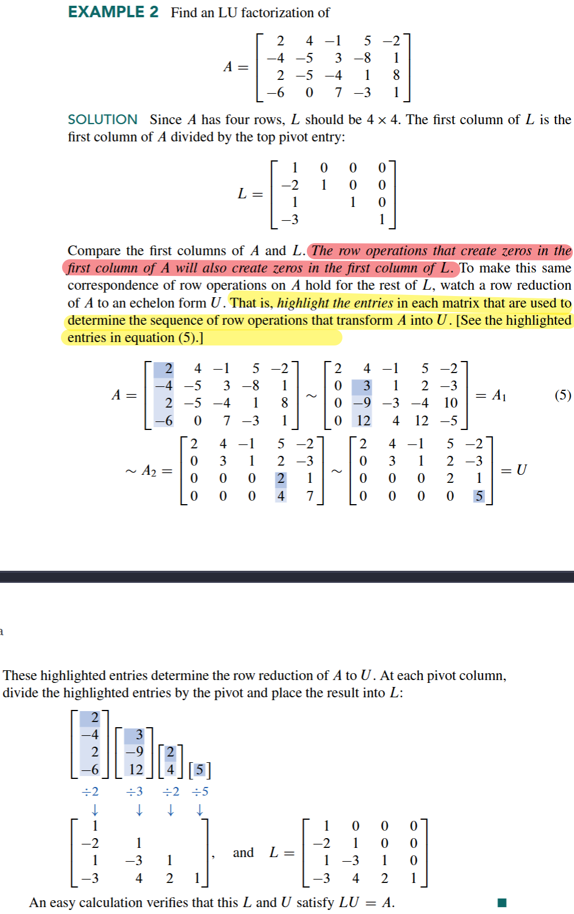
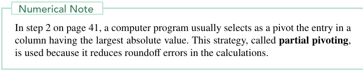
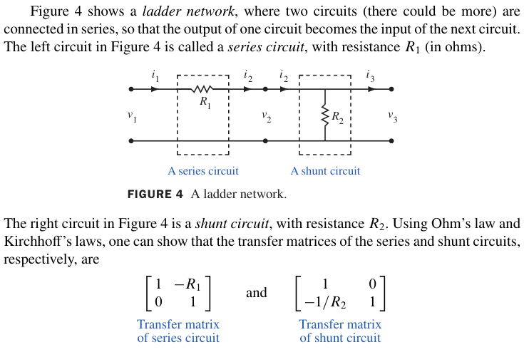

下面我们将会讨论 **矩阵分解** 的概念。所谓矩阵的分解，就是把一个矩阵拆成几个矩阵的乘积。正如矩阵的乘法其实是对数据的 *合成（synthesis）*，矩阵分解其实是对数据的 *分析（analysis）*。  
在计算机科学的语言里，把 $`A`$ 表示成一个乘积等价于对 $`A`$ 中的数据做 **预处理**，把数据组织（ *organize* ）成两个或多个结构在某些程度上更有用的部分，可能是能更好地做运算。  
**矩阵分解** 以及后面我们要提到的 **线性变换的分解** 会在一系列 *key points* 中出现。这一节我们将要介绍一种在有着广泛应用的计算机程序中充当关键部分的分解。我们会在练习中见到其它的分解形式（还记得我们 [2.4 Partitioned Matrices](2.4%20Partitioned%20Matrices.md) 习题中的那个 *Schur complement* 吗？那就是一种分解带来的东西。）
### LU分解
提出这种方法的 *动机* 是我们在工业或者商业问题中经常要处理一系列有着相同系数矩阵的方程。比如 *exercise 32*。或者我们在很后面 5.8节 中将用 *inverse power method* 估计矩阵的特征值也要处理这个问题。  
当 A 可逆的时候，我们当然可以计算出逆然后左乘。但是一个更快的做法是：利用行简化得到第一个方程的解，同时得到一个 **LU facterization**，然后后面的每一个方程都可以利用 **LU分解** 快速解决。  
首先，我们假设一下 A 可以在 *不使用行交换* 的前提下完成行简化到 *REF*，然后 $`A`$ 就可以被写为 $`A=LU`$ 的形式，这里 $`L`$ 是一个 $`m\times m`$ 的下三角矩阵，对角元素均为 1，然后 $`U`$ 是那个 *REF*。就像下面这个图展示的一样。

在我们学习如何构建 L、U 之前，我们应该先看看：它们为什么是有用的。毕竟直观上来看我们我们把一个矩阵拆成了两个矩阵，矩阵数量上已经输了（  
当 $`A=LU`$ 的时候，这个方程 $`A\mathbf{x}=\mathbf{b}`$ 可以被写成 $`L(U\mathbf{x})=\mathbf{b}`$，记 $`U\mathbf{x}=\mathbf{y}`$，我们就可以通过求解下面这个方程组来解出 $`\mathbf{x}`$：

$$
\begin{aligned}
L\mathbf{y} & =\mathbf{b} \\
U\mathbf{x} & =\mathbf{y}
\end{aligned}
$$

我们首先求解 $`L\mathbf{y}=\mathbf{b}`$ 解出 $`\mathbf{y}`$，然后求解 $`U\mathbf{x}=\mathbf{y}`$ 得到 $`\mathbf{x}`$。  
这样难道不是把求解一次方程变成求解两次方程，让问题更复杂了吗？恰恰相反！因为 $`L，U`$ 都是三角矩阵，所以求解起来并不困难。  
我们来看一个算例：

这大概是一个 $`m^2`$ 的复杂度，与之对比，我们可以看回我们很早之前的一个结论。

也就是正常做行简化求解方程大概是一个 $`n^3`$ 的复杂度。显然慢得多了。

> [!NOTE]
>不过这似乎并没有想象中的从 $`n^3`$ 到 $`n^2`$ 的大优化，因为我们还没有说明我们是怎么得到这个 LU 分解的。正如我们后面要看到的，其实得到 LU 分解我们照样要进行一个 REF，这依然刚需一个 $`n^3`$ 的复杂度。只不过也就到 $`n^3`$ 了。还记得吗，我们其实主要是要解一堆拥有相同系数矩阵的方程组。这意味着在算完第一个方程之后，后面所有的方程都是 $`n^2`$ 了。这事实上也不能不说是一个很大的优化。

---
### 计算 LU 分解的算法
先假设 A 可以被只用 *row replacement* 简化到 *REF*，而且甚至我们对这个 *row replacement* 也有要求：它只能是原来的行加上一个在它之下的行的倍数。这样的话，就存在下三角矩阵$`E_{1},E_{2},\cdots E_{p}`$满足

$$
\begin{aligned}
E _{P}\cdots E_{1}A & =U \\
A & =(E_{p}\cdots E_{1})^{-1}U=LU \\
L & =(E_{p}\cdots E_{1})^{-1}
\end{aligned}
$$

我们可以证明：单位下三角矩阵的乘积仍是单位下三角矩阵。于是 L 即为所求。  
注意到行变换在把 A 变成 U 的同时把 L 变成了 I，于是我们就可以构造出 L 了：

这个第一步并不总是能做到的。但一旦能做到，我们就知道 LU 分解是存在的。第二步看起来很困难。但事实上我们有一个比较关键的 Notice 在这里：

> [!IMPORTANT]
> The row operations that create zeros in the first column of A should also create zeros in the first column of L

这样就比较好说了。一个具体的方法可以看这个 example：

当然，在实际的计算中，我们总是免不了要交换的，因为我们要做 *partial pivoting* 来获得更高的精确度。这件事情也是第一章里说过的。仍然引用一下：

为了处理行交换，我们会简单地改动一下上面的算法，得到一个 *permuted lower triangular*，置换下三角矩阵。因此对行的一个重排（术语是置换，*permutation* ）就可以得到一个下三角矩阵。

### 电路中的矩阵分解
这一块的内容其实就是一个抽象过程。也就是 *input->transfer->output* 的一个过程。这里以电路为例子。给出了串联和并联的 *transfer matrix*。  
仍然说一下我们为什么会引入这样一个矩阵。我们基于这样一个考量：很多时候，输出和输入之间的关系是线性的，于是我们可以用一个矩阵来描述。这个矩阵就被我们称为转移矩阵（ *transfer matrix* ）。

这是很显然的串联和并联电路的转移矩阵。算例比较没意思这里就不贴了。这里重要的还是这个输入-输出的思想。为了建立一个可用的，具有一定性质的网络，工程师们首先判断这个网络是否可以被建造出来，然后他尝试把这个转化矩阵拆成几个矩阵的乘积，这些矩阵可能对应一些小的电路，它们可能已经被制造出来，可以被安装了。在常见的交流电情况中，转移矩阵的元素通常是有理复值函数。（参见 2.4 节的练习 21 和 22。）一个标准问题是寻找使用最少电气元件的最小实现方案。