### 1.5 37

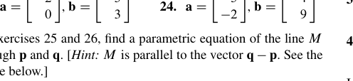

其中 Theorem 6 指的是：  
Solution:

$$
A \vec{v_{h}}=A (\vec{w}-\vec{p})=A \vec{w}-A \vec{p}=\vec{b}-\vec{b}=\vec{0}
$$

### 1.7 42

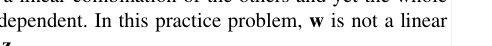

Counterexample:

$$
\begin{bmatrix}
  1& 0 & 0 & 0\\
  0&  0& 1 & 0\\
  0& 0 & 0 & 1\\
 0 & 0 & 0 &0
\end{bmatrix}
$$

### 1.8 27

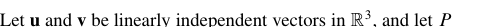

这个很有意思的是反例不大好找。如果你只是想一些简单的变换是无济于事的。但是 **求导** 也是线性变换。

### 1.8 38

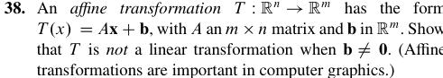

证明是简单的。我们可以继续下来探讨一下仿射变换(affine transformation).  
它应该也可以拥有一个这样的形式：

$$
T(\vec{x})=A(\vec{x}+\vec{b})
$$

当然，也许 A 的值域并非 $\mathbb{R}^m$，所以上面的形式并不完备。  
加 $\vec{b}$ 的行为可以看成是将原来线性变换的结果做了一个平移，事实上也没有改变原来的形状，只是位置发生了变化。

### 1.9 41

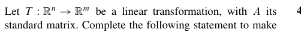

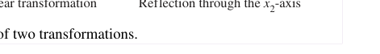

证明其实非常简单。

$$
\begin{aligned}
A\mathbf{x} = B\mathbf{x} = T(\mathbf{x}) \\
\therefore A\mathbf{x}- B\mathbf{x} = 0 \\
(A-B)\mathbf{x} = 0
\end{aligned}
$$

要让这个式子恒成立，显然 $A = B$。

### 2.1 T11

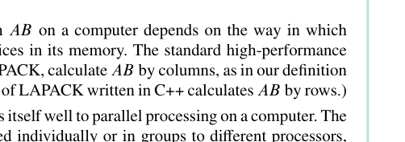

主要是第二个问题。也就是找到一个 $B$ 矩阵。一个显然的答案是 $\alpha I_{3}$，但是我们也可以去求矩阵的逆。  
这个求法当然有公式，但是也有一个比较好的想法。就是*当我做行简化的时候，（对于方阵）我最后也会得到一个单位矩阵。* 那么相当于 $BA=I$，要求 $B$ 的话，我们只需要对 $I$ 做相同的操作就 OK 了。  
对于这道题，我最后化简到的结果是：

$$
\begin{bmatrix}
1&0.5&-0.5 \\
1 & -2 & 1 \\
-1 & 1.5 & -0.5
\end{bmatrix}
$$

也是可行的。

### 2.1 T30~T34

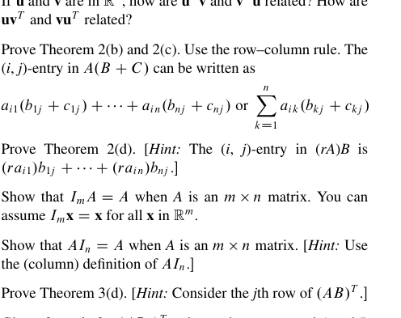

30 这是一个很有意思的性质。也就是**矩阵变换不改变原矩阵各列的线性相关**（当然并没有提出*如果原矩阵线性无关会怎么样*）。证明也很简单，因为如果 B 的各列是线性相关的，某个列向量就一定能写成其它列向量的线性组合，而这个线性组合整体被 A 作用一下仍然成立，这就结束了。  
这样我们也就很自然地有了 31 的证明。也就是如果有非平凡解，那么 A 的各列线性相关 [见 1.7线性无关 的这里](第一章/1.7%20Linear%20Independence.md#引入)，这样我们就不可能得到一个各列向量线性无关的单位矩阵 $I_{n}$。那既然都线性无关了，那 A 也就不可能列比行多了。  
而 32 则更进一步。它的证明（在提示下）是简单的。显然 $D$ 得是一个 $m$ 列的矩阵，那它与 $\mathbf{b}$ 的乘积就是有定义的。我们只要让 $\mathbf{x}=D\mathbf{b}$ 就得到了答案。那显然对任意的 $\mathbf{b}\in\mathbb{R}^m$ 都是有解的嘛。但是这样就要求 $A$ 的各列张开 $\mathbb{R}^m$，这显然需要让 $A$ 有大于等于 $m$ 列。这就很轻松地说明了这个题。  
把 $31,32$ 放在一起看，我们不难发现：如果同时有 $CA=I_{n}$ 和 $AD=I_{m}$， A 只能为方阵，且一旦 A 确定下来，$C$ 和 $D$就是确定的，而且 $C=D$。这就是我们的 33 题。  
不过，存在 $CA=I_{n}$ 不意味着存在 $AD=I_{m}$。这就是 34 题可以告诉我们的。这个找法可以是：分别找到 $A\mathbf{x}=\begin{bmatrix}1 \\  0 \\  0\end{bmatrix},\begin{bmatrix}0 \\  1 \\  0\end{bmatrix},\begin{bmatrix}0 \\  0 \\  1\end{bmatrix}$ 的解 $\mathbf{x_{1},x_{2},x_{3}}$，然后 $D=\begin{bmatrix}\mathbf{x_{1}} & \mathbf{x_{2}} & \mathbf{x_{3}}\end{bmatrix}$。  
也可以是其它方法。详见[2.1 T34补充](2.1%20T34补充.md)

### 2.1 T35-36

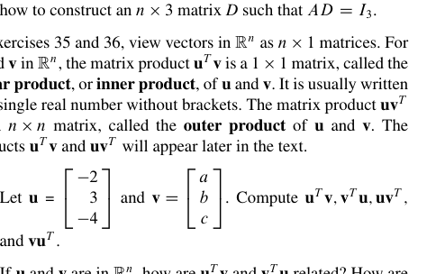

这里引入了内积（标积）和外积的概念。  
内积是 $1\times n$ 和 $n\times 1$ 的乘法，最后当然得到一个数。  
外积是 $n\times 1$ 和 $1 \times n$ 的乘法，最后会得到一个 $n \times n$ 的矩阵。  
分别可以写成$\mathbf{u^T v}$和$\mathbf{uv^T}$

它们也会在后面出现。这里先看一个比较简单的性质。那就是 $\mathbf{u^T v}=\mathbf{v^T u}$。这很显然，因为本来是转置的，但是 $1 \times 1$ 的矩阵转置不就是自身吗？所以就相等了。

### 2.1 T41

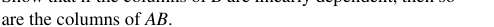

$$
\begin{aligned}
(AB)^T _{ij} & =(row_{i}(A)\cdot column _{j}(B)) \\
 & =(row_{j}(B^T)\cdot column_{i}(A^T)) \\
 & =(B^TA^T)_{ij}
\end{aligned}
$$

### 2.1 T47

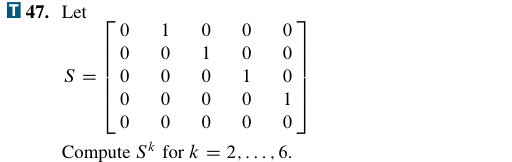

这是一个所谓的 **上移位矩阵**，或者叫 **幂零矩阵**。  
这是 T47，矩阵 $S$ 是一个典型的**上移位矩阵**（或称为超对角移位矩阵）。它的规律非常漂亮：随着乘方次数增加，非零元素会不断向右上方“移动”，最终移出矩阵，全部变成 0。

#### NumPy 验证代码

```python
import numpy as np

# 构造 5x5 的上移位矩阵 S
S = np.diag([1, 1, 1, 1], k=1)

for k in range(2, 7):
    print(f"S^{k} = \n{np.linalg.matrix_power(S, k)}\n")
```

#### 输出结果

$$
S^2 = \begin{bmatrix} 0 & 0 & 1 & 0 & 0 \\ 0 & 0 & 0 & 1 & 0 \\ 0 & 0 & 0 & 0 & 1 \\ 0 & 0 & 0 & 0 & 0 \\ 0 & 0 & 0 & 0 & 0 \end{bmatrix}
$$

$$
S^3 = \begin{bmatrix} 0 & 0 & 0 & 1 & 0 \\ 0 & 0 & 0 & 0 & 1 \\ 0 & 0 & 0 & 0 & 0 \\ 0 & 0 & 0 & 0 & 0 \\ 0 & 0 & 0 & 0 & 0 \end{bmatrix}
$$

$$
S^4 = \begin{bmatrix} 0 & 0 & 0 & 0 & 1 \\ 0 & 0 & 0 & 0 & 0 \\ 0 & 0 & 0 & 0 & 0 \\ 0 & 0 & 0 & 0 & 0 \\ 0 & 0 & 0 & 0 & 0 \end{bmatrix}
$$

$$
S^5 = \begin{bmatrix} 0 & 0 & 0 & 0 & 0 \\ 0 & 0 & 0 & 0 & 0 \\ 0 & 0 & 0 & 0 & 0 \\ 0 & 0 & 0 & 0 & 0 \\ 0 & 0 & 0 & 0 & 0 \end{bmatrix}, \quad
S^6 = \begin{bmatrix} 0 & 0 & 0 & 0 & 0 \\ 0 & 0 & 0 & 0 & 0 \\ 0 & 0 & 0 & 0 & 0 \\ 0 & 0 & 0 & 0 & 0 \\ 0 & 0 & 0 & 0 & 0 \end{bmatrix}
$$

#### 关键结论
1. **$S^2$ 到 $S^4$**：每乘一次 $S$，非零的 $1$ 就向右上方移动一个位置。
2. **$S^5$**：$1$ 全部移出矩阵，变成 $5 \times 5$ 的零矩阵。
3. **$S^6$**：零矩阵乘任何矩阵都是零矩阵，所以结果依然是全零矩阵。
这种矩阵在数学上叫**幂零矩阵**（nilpotent matrix）。$S$ 的幂零指数是 $5$，即最小使得 $S^k = 0$ 的 $k$ 为 $5$。

### 2.1 T48

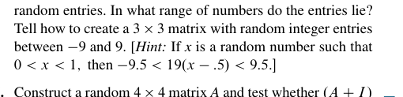

这是一个**双随机矩阵**。它每一个元素都大于 0，因此是 *不可约* 的且 *非周期* 的。我们有一个结论，就是这样的矩阵做足够多次幂运算后会收敛到一个特定的矩阵。在这里就是全为 $\frac{1}{3}$ 的矩阵。

```python
import numpy as np

A = np.array([
    [1/6, 1/2, 1/3],
    [1/2, 1/4, 1/4],
    [1/3, 1/4, 5/12]
])

for k in [5, 10, 20, 30]:
    print(f"A^{k} =\n{np.linalg.matrix_power(A, k)}\n")
```

输出中会看到 $A^{20}$ 和 $A^{30}$ 已经非常接近 $1/3$。

### 2.2 T23
乍一看这个好像和我们 2.1 给的一个 Warning 矛盾了。这个 warning 里说：  
[消去律对矩阵乘法不成立](第二章/2.1%20Matrix%20Operations.md#矩阵乘法)。  
可是不对啊，我们这道题里为什么就成立了呢？这是因为矩阵 A 可逆。这样我们就可以两边左乘 A 的逆了。  
但是还是要注意，如果这道题不是 $AB=AC$ 而是 $AB=CA$，我们就不能消去 A 了，我们尝试左乘 A 的逆，会得到 $B=A^{-1}CA$，要想得到 $B=C$，我们需要 A，C 对易这个性质。而只从感觉上来说，相比对易，可逆是一个更容易得到的性质。

### 2.2 T33-34
我们事实上只需要利用前面的定理就可以完成证明。  
$A\mathbf{x}=\mathbf{0}$ 只有唯一解，根据 [Chapter 01 Summary#Theorem 11](第一章/Chapter%2001%20Summary.md#theorem-11) 知道这意味着 A 是一个单射，根据 [Chapter 01 Summary#Theorem 12](第一章/Chapter%2001%20Summary.md#theorem-12) 就可以知道 A 的各列线性无关，于是我们就可以由这个继续推出每一个在 $\mathbb{R}^{n}$ 上的 $\mathbf{b}$ 都是矩阵 $A$ 的列的线性组合，这样我们就可以继续由 [Chapter 01 Summary#Theorem 4](第一章/Chapter%2001%20Summary.md#theorem-4) 推出 A 在每一行都有一个 *pivot position*，这和 A 有 n 个 *pivot column* 是一个意思，和 A 与 $I_{n}$ 行等价也是一个意思。这样就证完了。  
$A\mathbf{x}$ 是一个满射，这事实上又意味着我们可以通过 [Chapter 01 Summary#Theorem 4](第一章/Chapter%2001%20Summary.md#theorem-4) 得到和上一题一样的结论。

### 2.4 T 17-18，20-22
这几道题有一个统一的主题，就是所谓的 **Schur Complement**。  
当然，我们这里其实没有给一个，至少在我看来，很完备的定义。我们其实只针对 $2 \times 2$ 的分块矩阵给出了对角线 *entry* 的 **Schur Complement** 的定义。  
它首先要求这个对角元素是可逆的，但也只限于此。其它三个元素的形式完全没有要求。  
然后我们其实是把一个矩阵拆成了三个分块矩阵的乘积。先是一个下三角，再是一个对角矩阵，最后是一个上三角矩阵。

$$
\begin{bmatrix}
A_{11} & A_{12} \\
A_{21} & A_{22}
\end{bmatrix}
=\begin{bmatrix}
I & 0 \\
X & I
\end{bmatrix}
\begin{bmatrix}
A_{11} & 0 \\
0 & S
\end{bmatrix}
\begin{bmatrix}
I & Y \\
0 & I
\end{bmatrix}
$$

求解 $X，Y$ 其实并不难。我们简单地做一下矩阵乘法马上就可以得到：

$$
\begin{aligned}
X  & = A_{21}A_{11}^{-1} \\
Y  & = A_{11}^{-1}A_{12} \\
S  & = A_{22}-A_{21}A_{11}^{-1}A_{12}
\end{aligned}
$$

最后一个 $S$ 就是所谓的 $A_{11}$ 的 **Schur Complement**。  
同理，如果那个对角矩阵选的是保留 $A_{22}$，我们也可以得到一个 $A_{22}$ 的 **Schur complement**。

$$
S = A_{11}-A_{12}A_{22}^{-1}A_{21}
$$

这样我们还可以做的一件事情就是对这个矩阵 *求逆*。当然少不了的要求这个矩阵本身可逆，然后 $A_{11}$ 可逆。我们可以很简单的利用矩阵乘积的逆等于反序做它们的逆的乘积：

$$
A^{-1}=\begin{bmatrix}
I & -Y \\
0 & I
\end{bmatrix}\begin{bmatrix}
A_{11}^{-1} & 0 \\
0 & S^{-1}
\end{bmatrix}
\begin{bmatrix}
I & 0 \\
-X & I
\end{bmatrix}
=\begin{bmatrix}
A_{11}^{-1}+YS^{-1}X & -YS^{-1} \\
-S^{-1}X & S^{-1}
\end{bmatrix}
$$

当然这里我们用到了 $S^{-1}$，那么显然要说明 $S$ 可逆。不过这不难说明。考虑那个分解形式，然后显然这三个矩阵都要可逆。那个对角矩阵可逆的条件就是 $S,A_{11}$ 都可逆。  
个人觉得：T 20 最大的作用就是引出我们的 T 21 和 T 22。  
它给出了一个很有用的形式。也就是我们下面的这个形式：

$$
\begin{bmatrix}
A-sI_{n} & B \\
C & I_{m}
\end{bmatrix}
\begin{bmatrix}
\mathbf{x} \\
\mathbf{u}
\end{bmatrix}
=
\begin{bmatrix}
\mathbf{0} \\
\mathbf{y}
\end{bmatrix}
$$

这里的 $\mathbf{u}$ 是一个所谓的 *input*，也就是输入。$\mathbf{y}$ 是一个所谓的 *output*，也就是输出。$\mathbf{x}$ 是一个所谓的 *state vector*。题 21 给了我们一个解法。就是先解 $\mathbf{x}$ 再代入反解 $\mathbf{y}$，中间的过程我们就省略了。最后我们可以给出这个答案：

$$
\mathbf{y}=(-C(A-sI _{n})^{-1}B+I_{m})\mathbf{u} = W(s)\mathbf{u}
$$

这是一个转换关系。也就是我们把 $\mathbf{u}$ 线性变换到了 $\mathbf{y}$。我们把 $W(s)$ 称为一个 *transfer function*。我们发现，这个所谓的 *transfer function* 其实就是我们 $A-sI_{n}$ 的一个 **schur complement**。  
以及我们还可以对这个 *transfer function* 在一定条件下求逆。我们 *可以* 证明，这个逆和我们一个矩阵的 **schur complement** 是一样的。这个矩阵是书上给出来的：

$$
\begin{bmatrix}
A-BC-sI_{n} & B \\
-C & I_{m}
\end{bmatrix}
$$

由此计算出来的逆是：

$$
S^{-1} = I_{m}+C(A-BC-sI_{n})^{-1}B
$$

